# Orca — a MoUI replica

A native, fully client-side replica of the **Orca agent IDE** desktop app, built with
[MoUI](https://github.com/wzzc-dev/moui) 0.9.1 in MoonBit. The app reproduces the
owner-supplied Orca reference screens in a pinned dark theme and runs as a native
Linux/Skia desktop window or as a WebAssembly web build.

The UI is state-driven with MoUI's TEA-style `Program[Model, Msg]`: a single `Model`
holds the workspace, bot fleet and panel state, `update` is a pure `(Model, Msg) -> Model`
function, and `view` renders `View[Msg]` trees. Every pixel of chrome — traffic lights,
tabs, tool rows, chips, mascots, meters — is composed from MoUI primitives; no bitmap
assets are loaded.

## Screens

### Projects — worktree chat

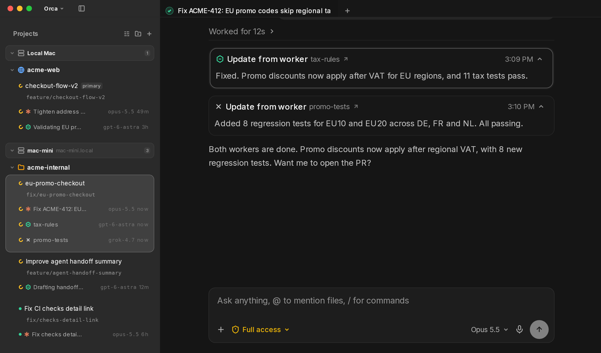

The default workspace. A 340 px sidebar lists machines and projects, worktree rows with
branch and agent metadata on a 316 px card span (28 px left / 12 px right inset), 28 px agent rows
with a 5 px gap (33 px pitch) and 10 px between the header, branch and agent sections,
and a Projects header that starts directly below the title bar, matching the reference.
Worktree cards use a 10 px top and 12 px bottom inset, which yields the reference's
~164 px selected card and a 12 px offset before the next card's header.
A single 36 px top row holds the title
segment over the sidebar and the worktree tab strip to its right; below it the main pane has
a scrollable transcript (user bubbles, assistant copy, collapsible worked rows, focused
worker cards, live status) and the Orca composer with a Full-access chip, model selector,
mic and send button.
A lone tab fills up to 375 px; once multiple tabs are open each tab caps at 300 px.
Completed worktrees get a 16 px done badge when the tab is at least 90 px wide, the close X
appears on hover, and long titles truncate at 48 characters.
Below 330 px the composer footer drops its plus/mic accessories and shortens the access
label (Full / Ask / Read) so the model chip and send button stay inside the card.
The placeholder trims to `Ask anything, @ to mention files, / for…` below 430 px and to
`Ask anything…` below 392 px so narrow panes never clip it.
Typing `/` opens a five-command picker (`/review`, `/test`, `/fix`, `/explain`,
`/summarize`), while typing `@` opens a file picker over the seeded source index.
Suggestions filter by command, path, project and summary; selecting one inserts the
command prefix or rewrites the unfinished mention with the full path. The plus button
opens the file picker by appending `@` to the draft. The same menus work in the Bots and
Diff composers, reserve space above the card so the transcript shrinks instead of the
card clipping, and close once a space completes the token. These prefixes are completion
text only; this backend-free replica does not execute shell commands. While a menu is
open, ↑/↓ move the highlight, Enter inserts the highlighted (or first) suggestion, and
Escape dismisses the menu without deleting the draft.
Each composer mic runs a deterministic local dictation demo instead of capturing audio:
the Projects/Bots mic appends `Summarize the failing checkout tests.`, the Bots comment
mic appends `Please add a regression test.`, and the Diff mic appends `The zero-rate
fallback looks right.`. The mic tints amber while its phrase is present and the Bots
caption reads `Dictated locally` at ≥360 px; the next edit, completion pick or send
clears the hint.

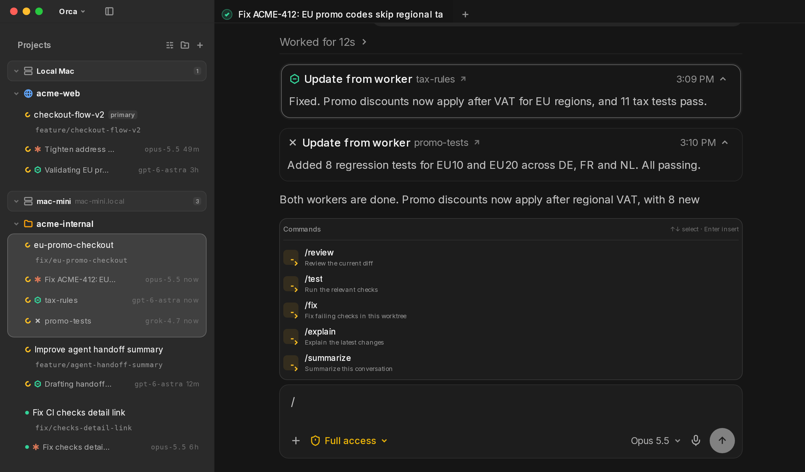

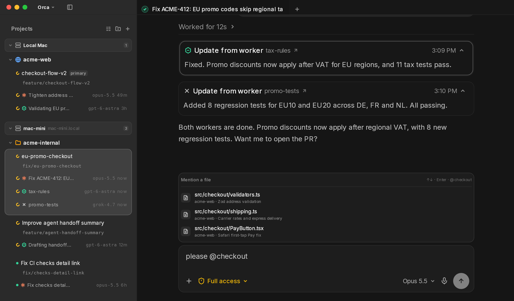

At compact widths the chat and composer keep 26 px side gutters, and user bubbles cap at
80% of the chat measure. The composer sits on a `#1d1d1d` card so it separates from the
`#151515` chat pane; the card is about 117 px tall (8 px padding, a 23 px gap before the
40 px footer) and sits 22 px above the window's bottom edge. The send button is a 40 px
light `#818181` circle with a dark arrow-up, matching the reference.
Worktree rows keep a 28 px left inset under the project name and a 12 px right inset so
timestamps end flush; as the sidebar nears its 220 px minimum, agent names clip harder and
the model token drops so times stay inside the card. The 10 / 12 px vertical inset also
keeps the reference's 164 px selected-card height and the 12 px gap to the next header.

Projects keeps the reference's uncluttered rail, so the shared Search / Tasks /
Automations / Bots nav is hidden here. Clicking the **Orca** wordmark (or the small
chevron beside it) opens a five-row page switcher with the current screen highlighted;
outside-click or `Escape` closes it. Search, Tasks, Automations and Bots keep the nav
rail, compact Projects still shows it inside the sidebar drawer, and `⌘P` / `Ctrl+P`
returns to Projects.

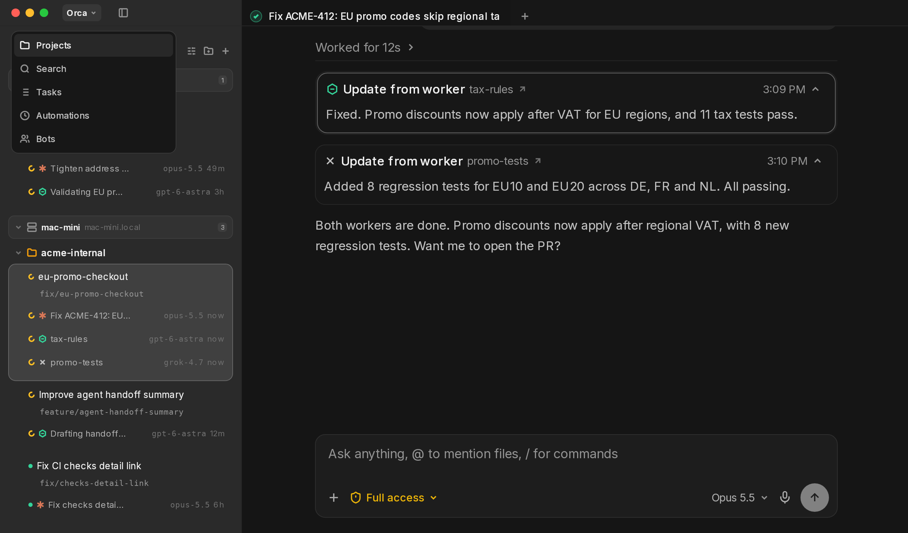

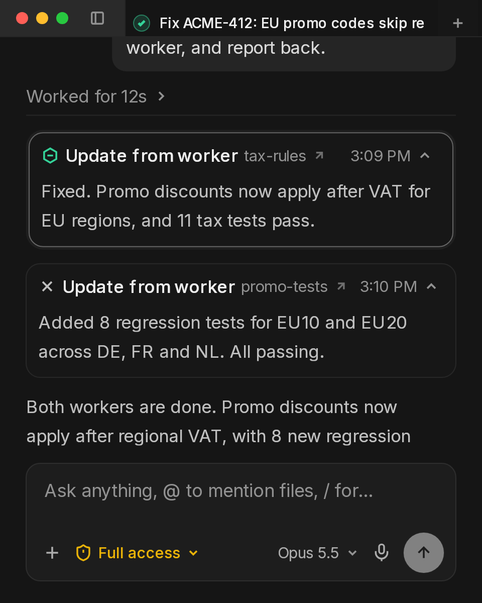

### Create worktree modal


Opened from the sidebar's plus / folder-plus buttons, the tab strip plus, or `⌘K`-style
flow. Project and Run-on selects, Create From chips (Smart / GitHub / Branch / Name), a
name field, an agent select, an Advanced disclosure, a Create-more toggle, and the
Create worktree action with a `⌘↵` hint. The type scale follows the reference: a 21 px
semibold header, 17.5 px select/field values, 15 px chips and an 18.5 px agent label.
Submitting creates a slugged worktree, adds it
to the selected project, opens its tab and seeds the new transcript. The chips change
what gets seeded: **Smart** uses the default checkout worktree, **GitHub** seeds a pull
request name and a `pr/<slug>` branch, **Branch** seeds a branch-derived `feature/<slug>`
worktree, and **Name** starts blank — it keeps the dialog open until a name is typed.
Opening **Advanced** reveals a base-branch selector that cycles `main` → `develop` →
`release/next`; the chosen base is recorded in the new worktree's setup worker. Below
680 px of viewport height the selector uses a compact 26 px row and drops the helper
line, so the dialog still fits at 320×600 and 480×600.
Below 360 px of content width the four chips reflow to a 2×2 grid, so all labels stay
legible at 320 px instead of clipping to `GitHu` / `BrancT`.
At 320 px the two 112 px selects clip their value text to a 36 px column, keeping the
project/host labels and both chevrons inside their fields instead of painting into the
neighbouring field or past the dialog card.
While that field is empty the primary button dims and the dialog shows a name hint.

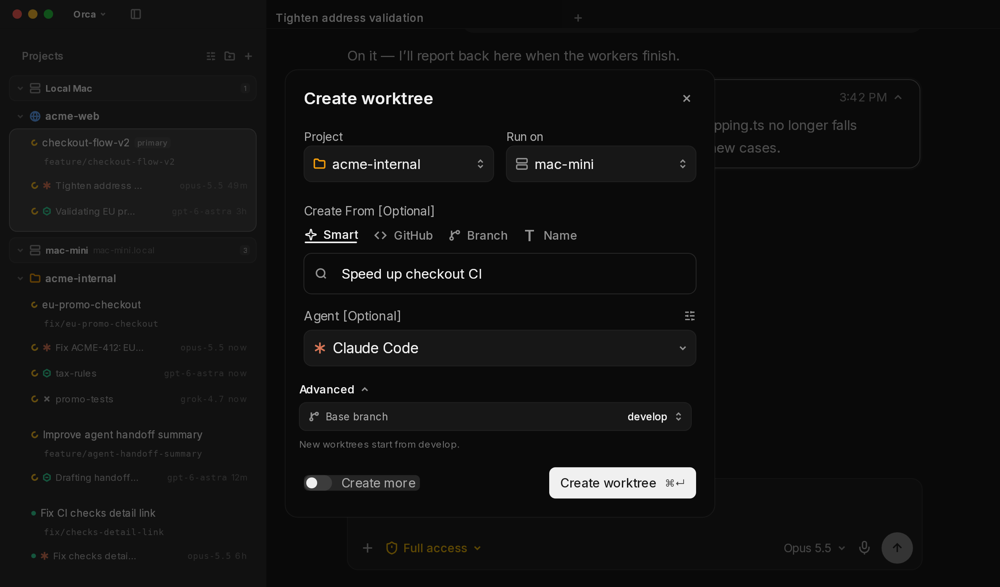

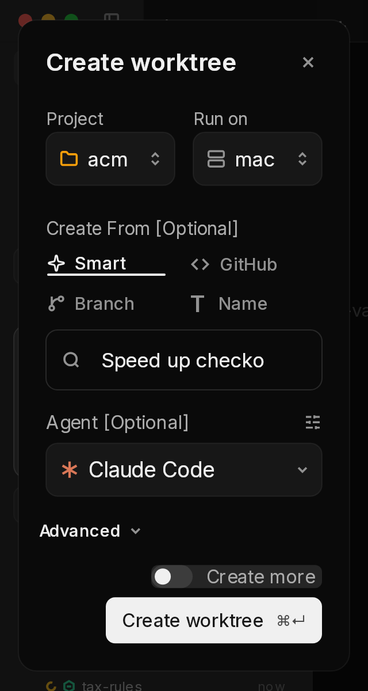

### Rename and delete worktrees

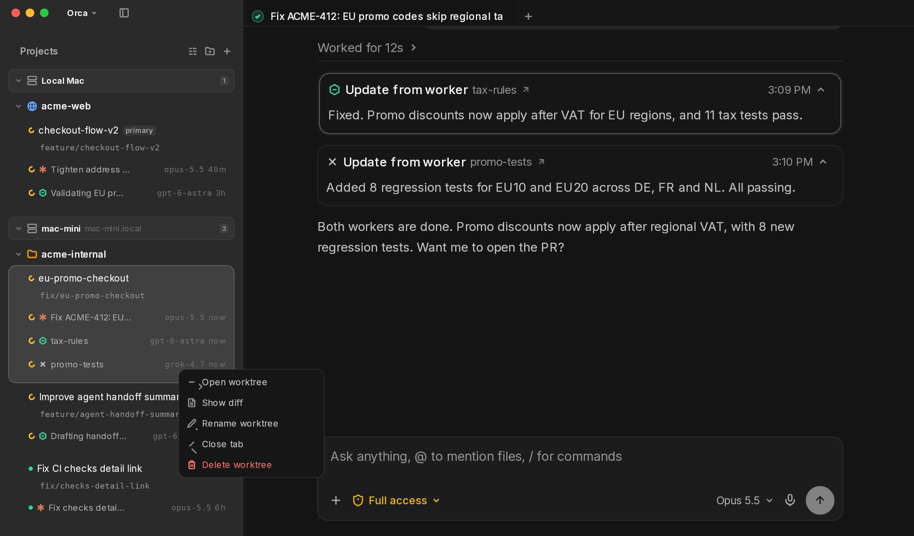

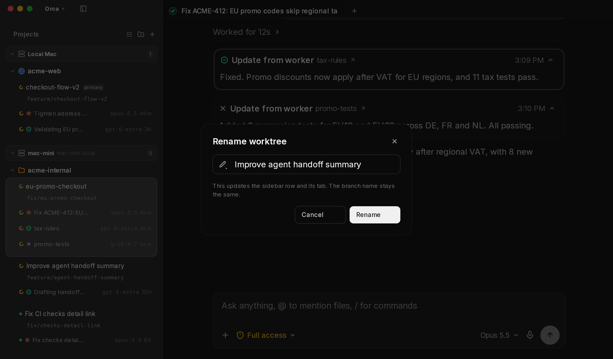

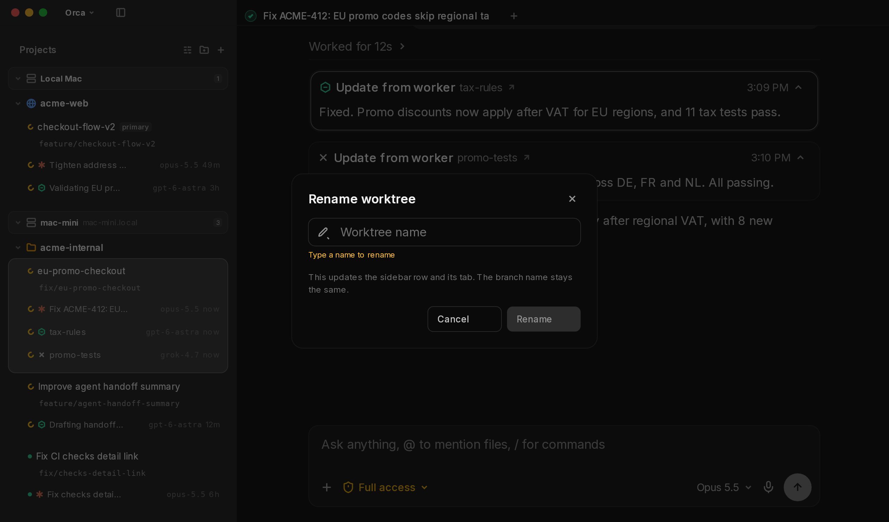

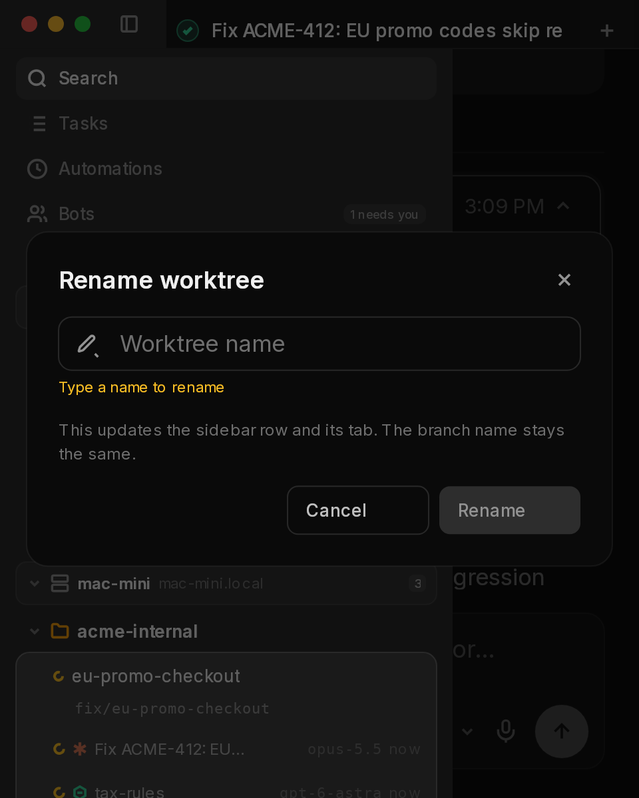

Right-click a worktree row and choose **Rename worktree** to edit its name in place; the
sidebar row and its tab title update together, while the branch stays the same. The same
menu offers **Delete worktree**, which asks for confirmation before closing the tab,
clearing task links that pointed at it, and removing the row from the sidebar and Search.
The **Rename** action stays dimmed until the field has a non-blank name; a blank draft
shows the amber `Type a name to rename` hint, and `↵` is a no-op.

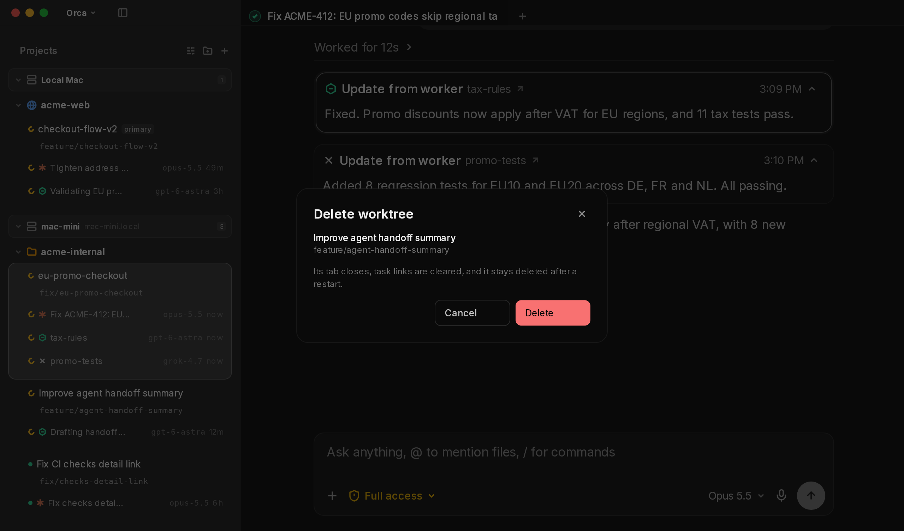

Deletions are recorded in the persisted state, so a deleted seed worktree does not return
after a restart, and creating a new worktree with a slug that was used before picks the
next available suffix.

### Bots — three-pane agent fleet

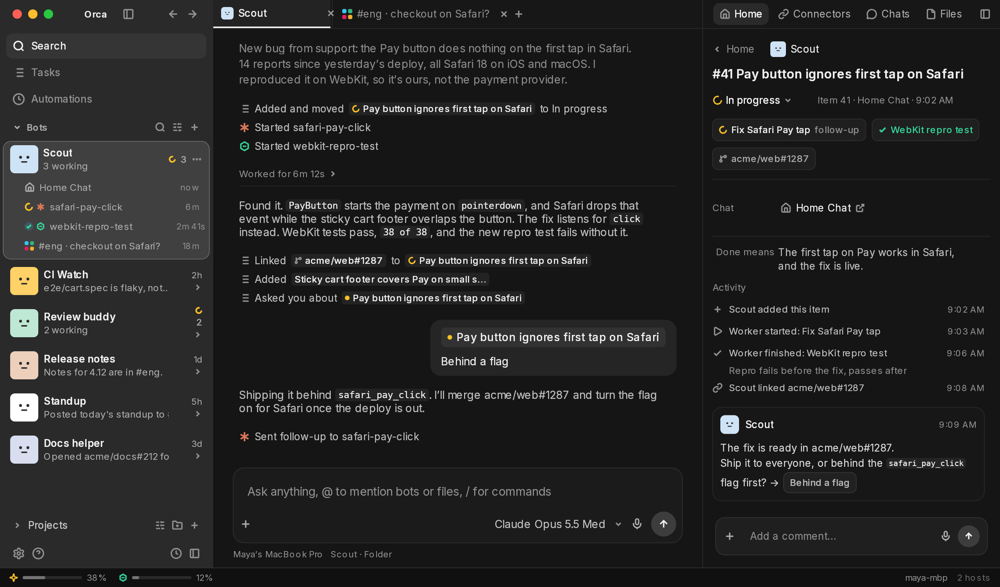

A resizable 220–380 px sidebar (272 px by default) with the bot fleet (selected Scout card
with nested Home Chat, Claude, Codex and Slack sessions), a resizable 320–480 px right item
panel (Home / Connectors / Chats / Files; 400 px by default, with icon-only tabs under
360 px), and the center Scout chat transcript and composer. A 24 px status bar spans the bottom
with deterministic capacity meters. The screen is reachable from the **Bots** row in the
wordmark page menu or the Search / Tasks / Automations nav rail; the sidebar's Projects
disclosure returns to the phase-1 workspace.
The Bots nav badge is live: it counts bots whose Home item says **Waiting on you** and
disappears when the count reaches zero, so a status-menu pick updates it immediately.
Only the bot header carries the selected card fill and border; its nested sessions sit
directly on the sidebar below it, matching the reference's 46 px highlight.
The selected mascot carries a 7 px amber status dot on a `#2a2a2a` ring at its
bottom-right corner, matching the reference.
The sidebar footer's far-right identity is a 28 px neutral account avatar with Maya's `M`
initial and a 10 px plus badge; the history and fleet controls stay to its left.
The right panel's panel button collapses it to a 48 px icon rail; picking a rail icon
reopens the panel on that tab.
The Bots header chevron collapses the fleet; its search icon filters bots by name, summary
or session label, sliders toggles the selected bot's nested sessions, and plus adds a new
bot. Every bot ships with its own sessions, so selecting CI Watch, Review buddy, Release
notes, Standup or Docs helper fills the sidebar, Chats panel and center tab. A newly added
bot starts with a Home Chat; its empty Home panel offers **Open Home Chat** rather than a
dead end, and that chat opens with a ready-to-start intro instead of borrowed seed activity.
The intro and its `Waiting for your first message` row give way to the real conversation
after the first send, and that message creates the bot's first real Home item (`#43`, then
`#44`, …): its title comes from the message, it starts **In progress**, carries Home Chat
chips, a Done-means line and Add / Worker-started activity, and the bot switches to
`1 working`. Messages sent from the bot's default view and from its Home Chat session
share one key, so opening Home Chat never hides what was just sent. Created items and their
activity are written to the app state file and restored on the next launch.
The Projects disclosure sliders jumps to Projects with its display-options panel open.
The Connectors tab lists Slack, Linear, GitHub and Gmail; clicking a row expands a status
card with its description and a Connect / Disconnect action, and the header shows how many
services are connected.
The Home tab's breadcrumb and Chat row are tappable: clicking **Home** or **Home Chat**
opens that bot's home session in the center pane, matching the external-link affordance.
The Home status row is a real menu trigger: the amber chevron opens an inline
In progress / Waiting on you / Done menu, a check marks the current state, and picking one
overrides that bot's seeded state, appends `Status set to …` to that item's persisted
activity history, and survives restarts. Repeated changes accumulate in the timeline;
picking the current state does not duplicate a row. Each bot keeps its own override;
switching bots, panel tabs or pages and pressing `Escape` close the menu.
The Files tab filters the indexed source list live by path, project, summary or code
keywords, shows the match
count, and falls back to a “No files match” row.
The center composer's mic inserts its local dictation sample and, at ≥360 px, shows the
amber `Dictated locally` caption under the device line; the comment composer does the same
with its own sample. No microphone permission or audio capture is involved.

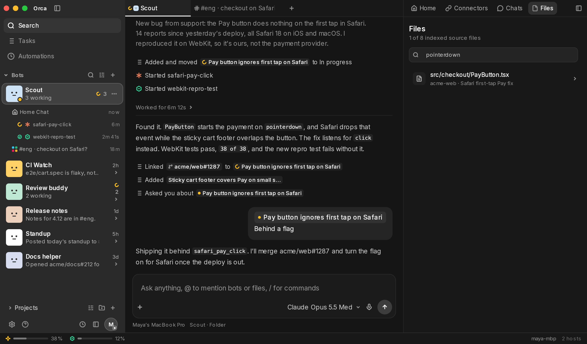

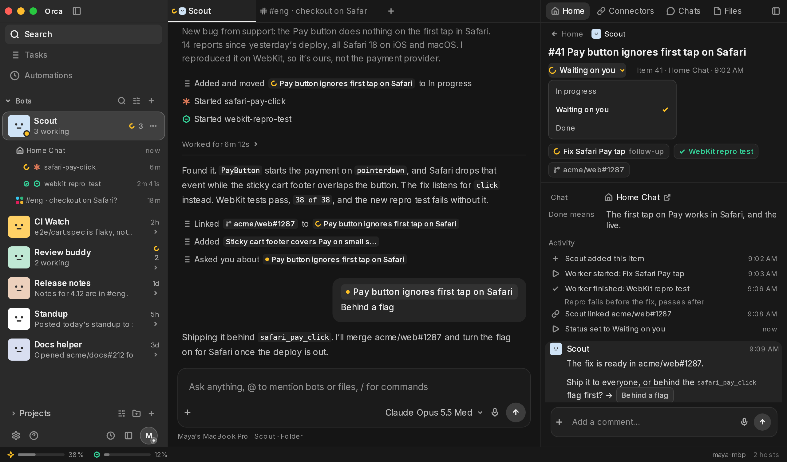

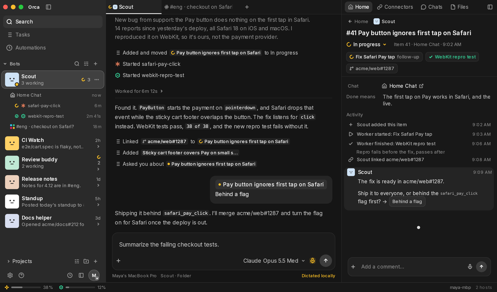

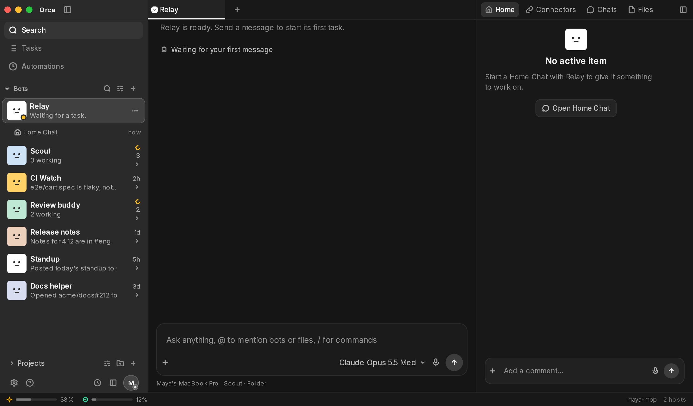

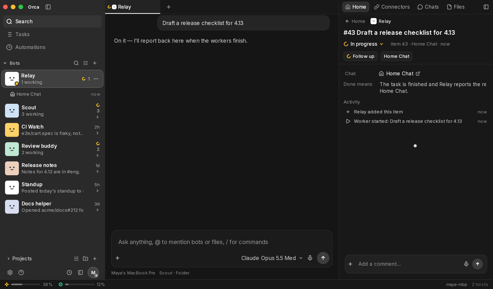

The sidebar footer's settings icon opens the fleet options, the help icon opens the
keyboard-shortcuts overlay, and the history icon jumps to the Chats tab.

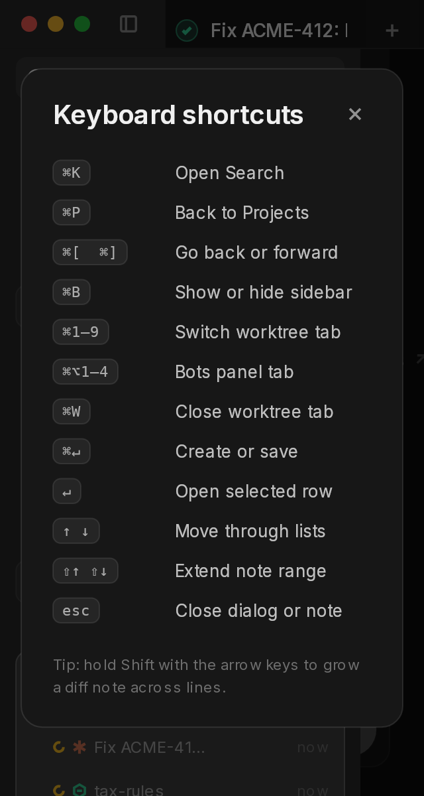

At 320 px the card keeps all twelve key chips but switches its labels to short actions
such as `Create or save` and `Switch worktree tab`, so no row runs past the card's right
edge.

The center tab follows the selected bot (avatar + name), with the `#eng` tab shown only
for Scout, and Escape closes the filter or display-options panel. The active center tab
keeps the reference's 2 px white baseline; the bot tab prefixes a 12 px mascot (plus an
amber spinner while that bot is working), and the Slack tab prefixes a hash glyph at the
same x as the reference. At the default 272 px sidebar width the session label column
gets 165 px, so `#eng · checkout on Safari?` renders in full instead of ellipsizing.
Its center strip is 383 px wide: the bot Home tab is 143 px, `#eng` is 196 px, and the plus
button follows them.
Below 760 px the fleet becomes a dismissible drawer and an open item panel is drawn over
the chat at up to `window - 64` px wide, so the chat keeps the remaining width instead of
being squeezed between two fixed panes. The 48 px item rail stays available to reopen the
panel, and the sidebar drawer takes priority when both side panes are open. `⌘⌥1–4` jumps
straight to the Home / Connectors / Chats / Files panel tab. When that 64 px chat peek
would push the drawer below its 320 px minimum, the phone drawer fills the window instead.
At phone widths the title bar drops the wordmark, and the center strip sheds the `#eng` tab
so the active bot tab, its close X and `+` stay usable down to 320 px (the strip has no
history arrows; those live in the Projects tab strip). When the item panel is the drawer,
its Home cards switch below 360 px to a single-column layout: the item title wraps to two
lines, activity labels clip inside the panel, chips stack one per row, and Done means
wraps in place. Below 400 px the status bar drops the second
usage meter so the machine and host labels stay inside the window.
The Bots composer also trims its placeholder by width: `Ask anything…` on phone panes and
`Ask anything, @ bots or files, / for…` at 480 px, so the single-line field never cuts a
word in half.

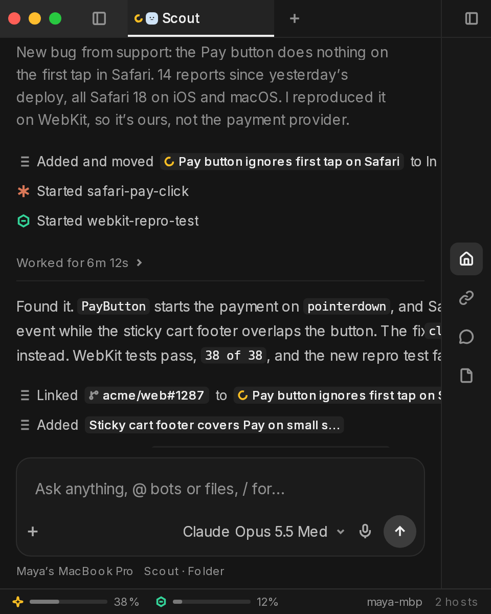

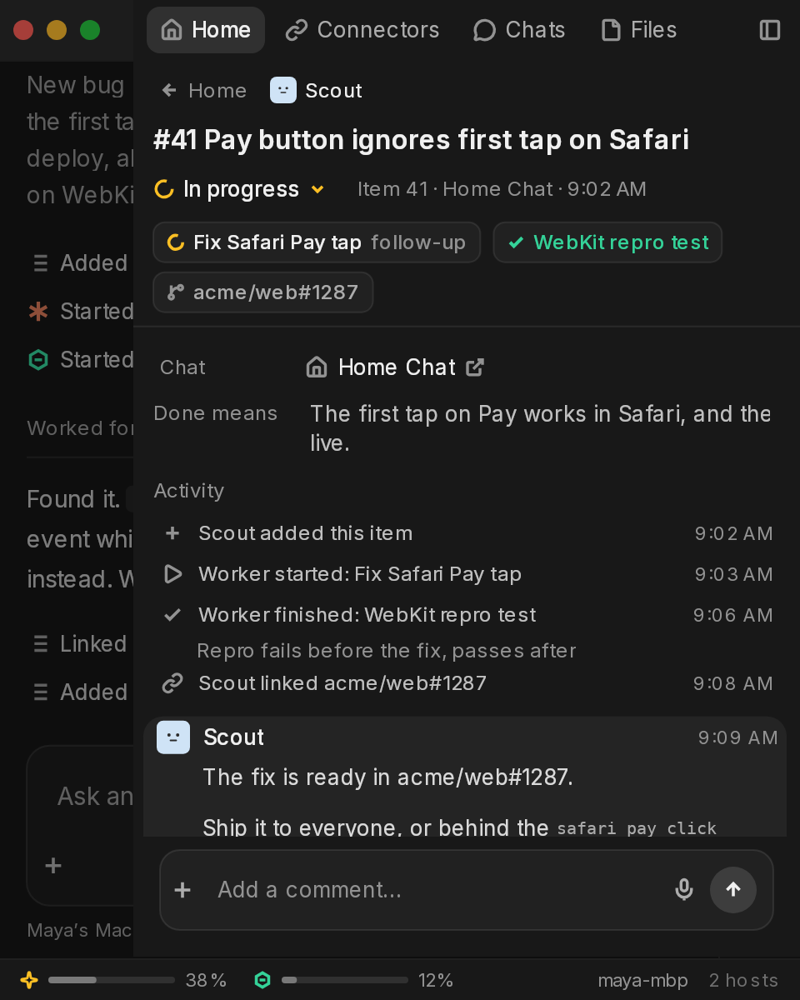

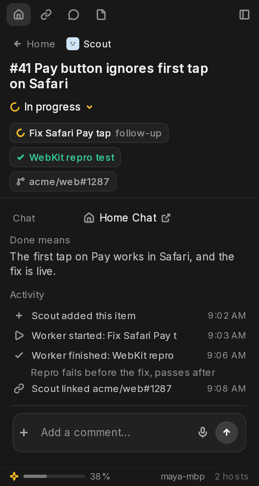

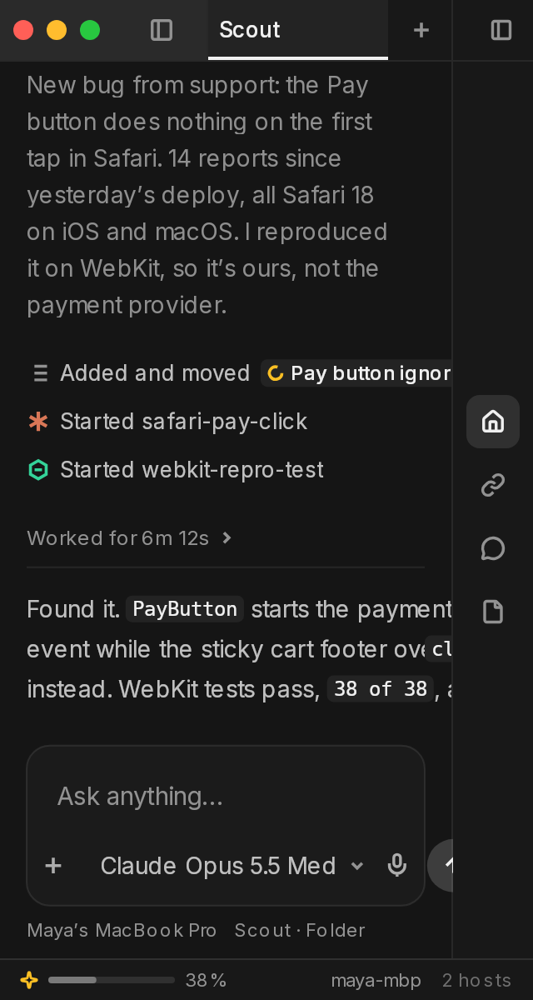

### Search — fleet-wide finder

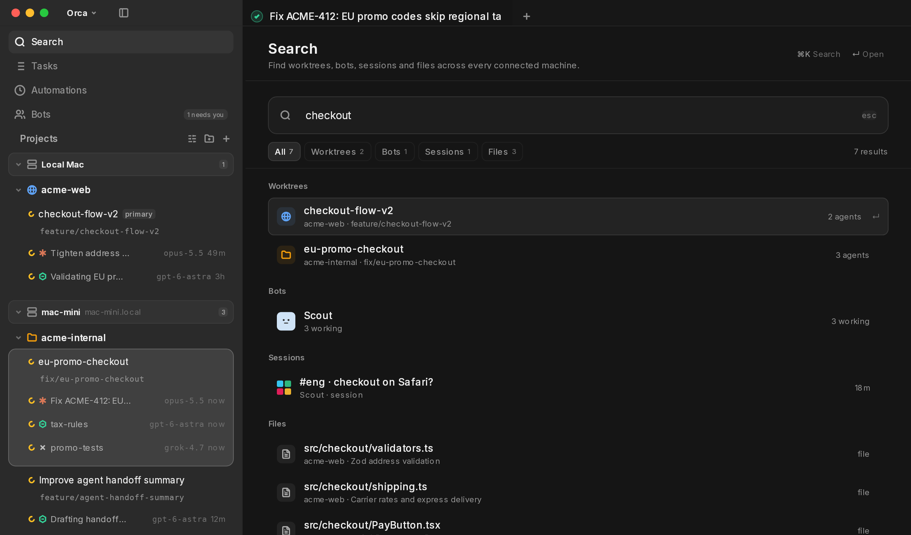

A page header, a 52 px search field with an `esc` clear hint, category pills
(All / Worktrees / Bots / Sessions / Files) and grouped result rows. Typing filters live;
the category pills narrow the list and the result count, suggestion chips fill the query,
the selected result carries the `↵` hint and ↑/↓ move it, and clicking a row opens the
matching worktree or bot. The **Files** category searches a seeded source-file index
(`validators.ts`, `shipping.ts`, `PayButton.tsx`, tax rules, CI checks and more) by path,
project, one-line summary and indexed code keywords, so queries like `pointerdown` or
`EU10` surface the owning file; the hit's subtitle shows its summary and clicking it
routes to the owning worktree.
Typing `@` scopes the search to files and switches the category pill to Files automatically
(for example `@checkout` lists the three checkout files without worktrees or bots); deleting
the `@` restores the previous category.
The header reserves the shortcut block's width and keeps the `⌘K Search` action flush
right; below 680 px the subtitle drops “across every connected machine” instead of
running into it.

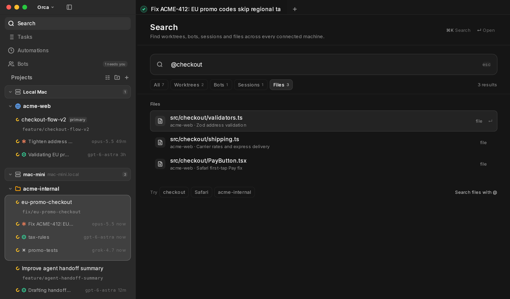

Below 620 px a result row clips its title and subtitle and sheds the right-hand metadata;
below 480 px the category pills use `Trees` and `Chats` with 6 px padding and 4 px gaps so
all five filters and the result total stay inside the 32 px gutter, and below 360 px the
result count becomes a bare number. At 480 px the full Worktrees / Sessions labels remain.
The header shortcuts stay visible at 320 px.

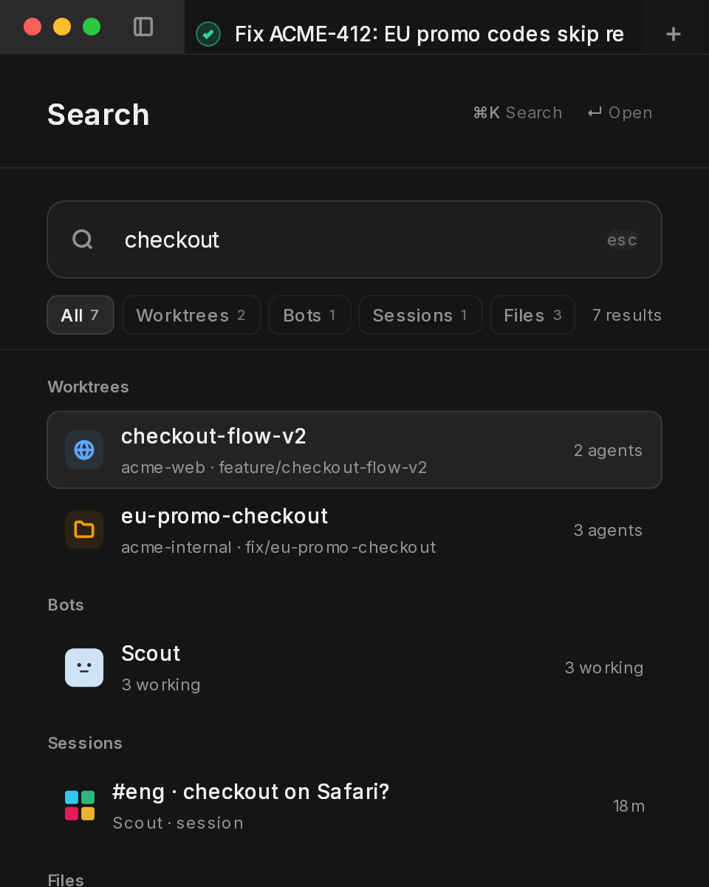

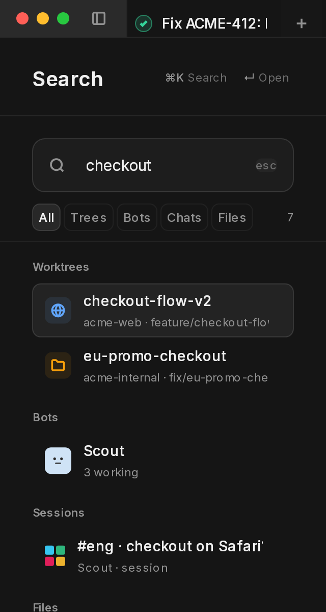

### Tasks — synced work items

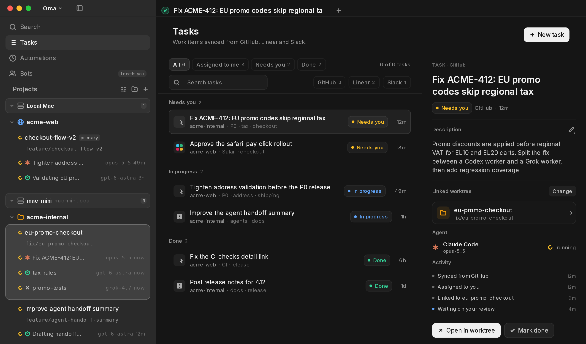

A list pane with status groups (Needs you / In progress / Done) and a 358 px detail pane
with description, linked worktree, agent, activity and actions. The status pills
(All / Assigned to me / Needs you / Done) and source pills (GitHub / Linear / Slack)
filter the list and its counts. Every task carries a seeded assignee, so **Assigned to me**
matches the tasks assigned to `you`, and the detail Activity list names the assignee;
the list is a persisted timeline: seed rows cover sync, assignee, link and agent state,
while Mark done, Reopen, relink/unlink, description saves, new tasks, created worktrees
and deleted worktrees append a `now` entry that survives a restart;
the search box matches title, repo, labels, description
and worktree; **New task** opens an inline title field with source (GitHub → Linear → Slack)
and agent (Claude Code → Codex → Grok) pickers; **Mark done** moves a task to Done and
**Reopen** sends it back to Needs you. Opening the composer switches to the list and
`Escape` dismisses it. **Add** stays dimmed until the title has a non-blank value; a blank
draft shows the amber `Type a task title to add` hint and `↵` does nothing. Filtering
re-settles both the detail pane and the highlighted row to
the first match, clearing any description draft that belonged to a hidden task; the detail
pane uses the real worktree branch and shows
`finished` instead of a running spinner for Done tasks. The Description pencil opens an
inline multiline editor; Save (or `⌘↵`) stores the new copy, Cancel (or `Escape`) restores it.
The header reserves 104 px for **New task**, so the action sits on the right edge rather
than butting against the supporting line.
The **Linked worktree** header exposes **Link** or **Change**: the unlinked card and the
header action both open an inline picker of every live worktree. Rows show name and branch,
the current link carries a green check, and picking a row relinks the task; **Unlink from
this task** clears the link. The picker only lists worktrees that still exist, and the
binding survives a restart. `Escape`, switching tasks, filters/query changes, clearing
filters, **New task**, page changes and back/forward navigation close it. While it is
open, page-level `↵` and Tasks ↑/↓ stay inert.
At 320 px the single-pane detail column is 276 px wide; the picker header, its option
rows, **Create worktree** and **Unlink from this task** all stay inside its 22 px inset.
New tasks start with no worktree link, so the detail pane always asks for a live target
instead of inheriting a stale id. The picker's **Create worktree** row opens the same
create dialog; submitting it adds the worktree, links it to the task and closes the dialog.
Below 640 px the page switches to one pane: rows fill the window, tapping or selecting a
task opens its detail with a **Back to tasks** action, the source filters stack under the
search field, and the new-task composer stacks its field over the buttons. At the same
row width the list switches to a compact layout: the title and repo/labels line clip to a
computed width, the status pill stays visible, and timestamps drop below 380 px so rows
keep their right gutter at 320 px. The same computed width is used above the compact
threshold, so timestamps do not spill into the list padding at intermediate window sizes.
Below 360 px the four status pills tighten to 6 px padding and 4 px gaps so the trailing
total also stays inside the list gutter; the new-task composer also shortens `Claude Code`
to `Claude` so its source / agent / Add row fits the same gutter. At 360 px and above the
normal labels and padding fit.
The app shell turns the main sidebar into a dismissible
drawer, drops the title-bar wordmark and sheds history/plus tab-strip controls before
they overflow; page
headers drop their supporting line and filter pills use short labels (`Mine`, `Needs`,
`Trees`, `Chats`) so the page keeps the full window width.

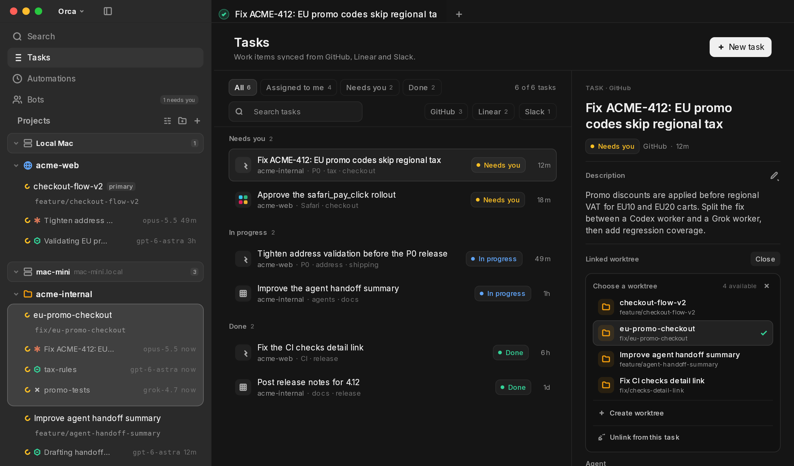

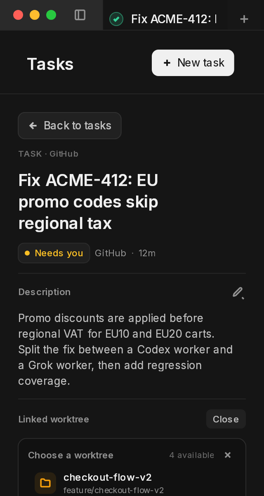

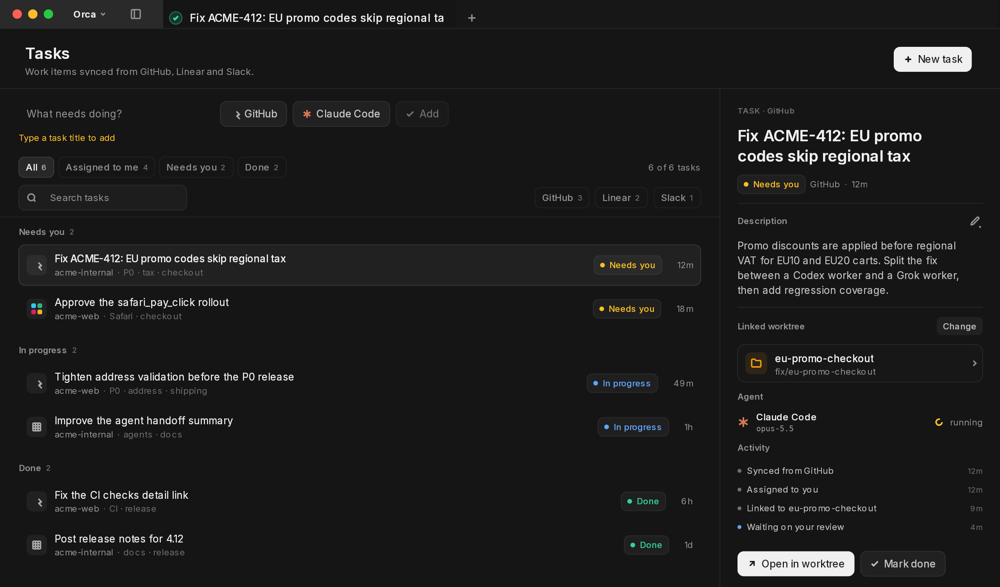

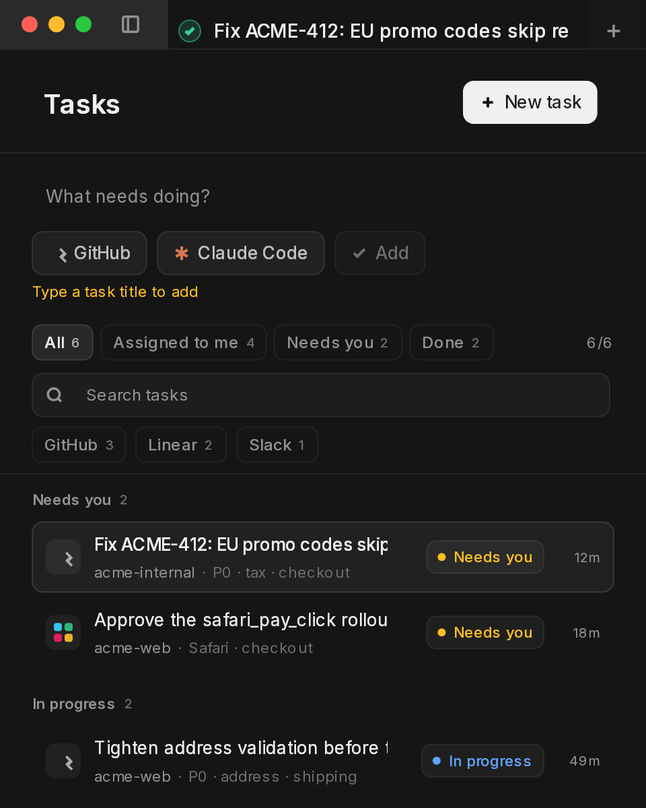

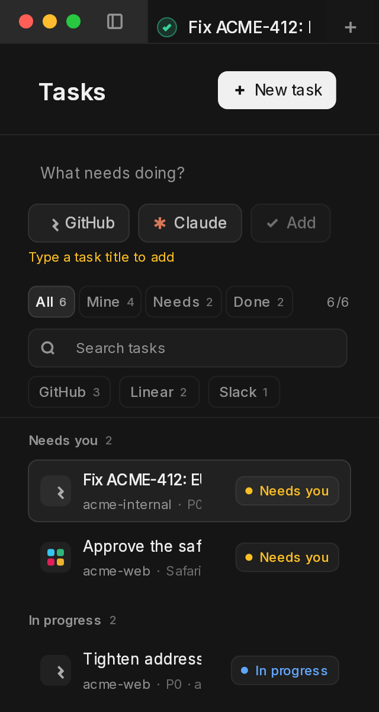


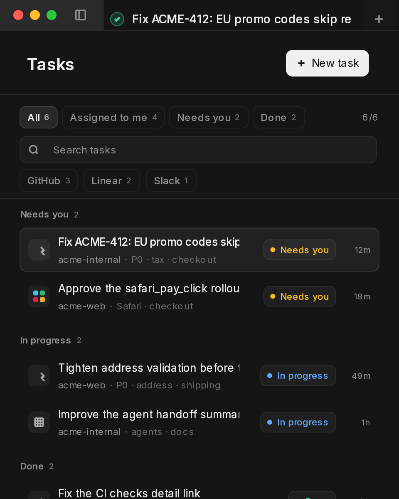

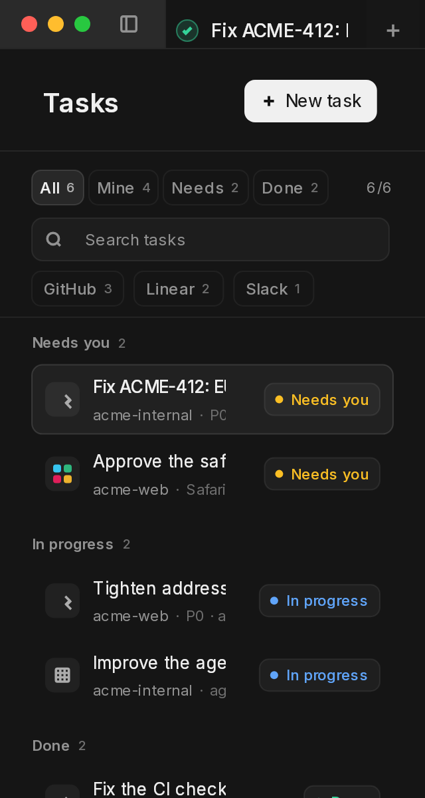

### Automations — scheduled runs


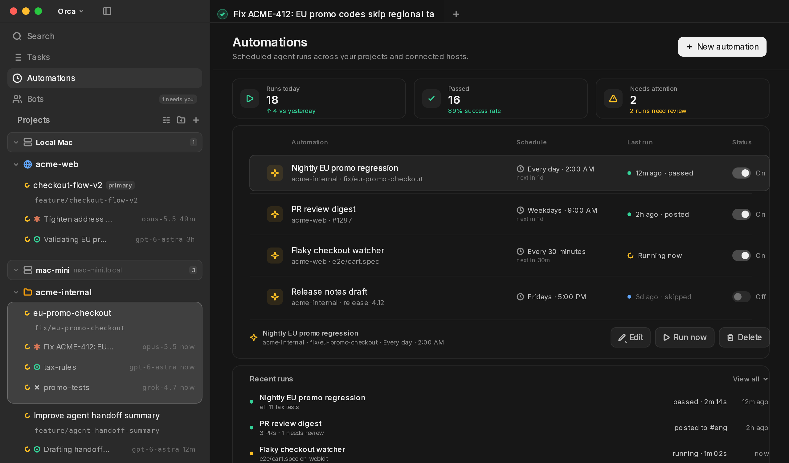

Three metric cards (runs today, passed, needs attention), a table with name / schedule /
last run / status, and a Recent runs card. Each row has a working enable toggle; selecting
a row reveals Edit / Run now / Delete actions under the table, and **New automation** opens
a 550 px editor dialog for the name, schedule and project (⌘↵ creates it). **Edit** reopens
the same dialog prefilled, **Run now** stamps a fresh last run, **Delete** removes the row,
and Recent runs toggles between the last three and all six runs. The Runs today / Passed /
Needs attention cards are live counters: **Run now** increments the run and passed totals and
the success rate recomputes from them. The `↑ N vs yesterday` helper is derived from the
persisted today/yesterday counters (it grows with Run now and reads `No change` or `↓ N`
when the delta is not positive). The primary **Save changes / Create automation** action
stays dimmed until the name has a non-blank value; a blank draft shows the amber
`Type a name to save` hint and neither the button nor ⌘↵ closes the editor. Run rows select
their owning automation, and editing a seeded automation keeps its canonical schedule
(Manual / Every 30 minutes / Every day · 2:00 AM / Weekdays · 9:00 AM / Fridays · 5:00 PM).
Below 560 px the table becomes stacked name/schedule rows with the toggle on the right,
the selected row gets compact Edit / Run now / Delete text actions, and the metric cards
drop their decorative glyphs. Metric, list and run cards share the same reserved card
padding and stay inside the 32 px page gutters down to 320 px, including intermediate
desktop widths. At those intermediate widths the trailing toggle/status column keeps its
natural 60 px and the selected-row actions reserve 294 px; only the name / schedule /
last-run text columns scale and clip, so Delete never paints past the card edge.
Deleting every automation switches the table to its `No automations yet` state and the
Recent runs card to `No runs yet` with an inline **New automation** action; the run
history toggle disappears instead of offering a dead `View all` control.
While the app is open, a host timer subscription ticks every 30 seconds. The first tick
arms every enabled non-manual schedule and adds a live `next in …` line to the table;
a due schedule appends a passed run, updates the same Run now counters, and re-arms.
Cadences are session-based (`Every 30 minutes` 30m, daily/weekdays 24h, Fridays 7d;
`Manual` never fires), so the countdown is not a wall-clock calendar trigger, and due
times reset on restart instead of firing stale runs.
At 320 px the header reserves 72 px for the short **New** action, so the button ends two
logical pixels inside the 32 px gutter instead of touching the content edge.

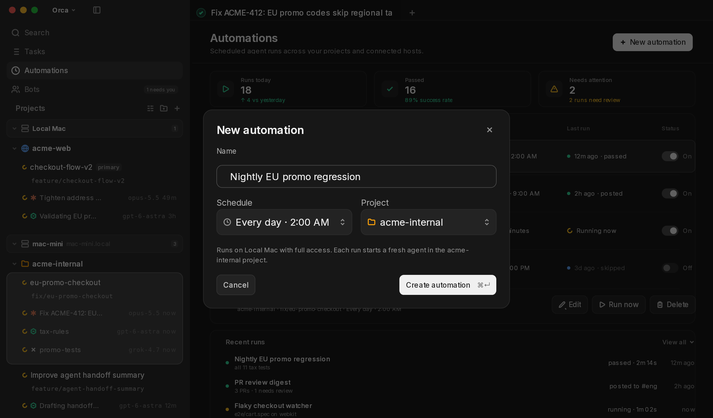

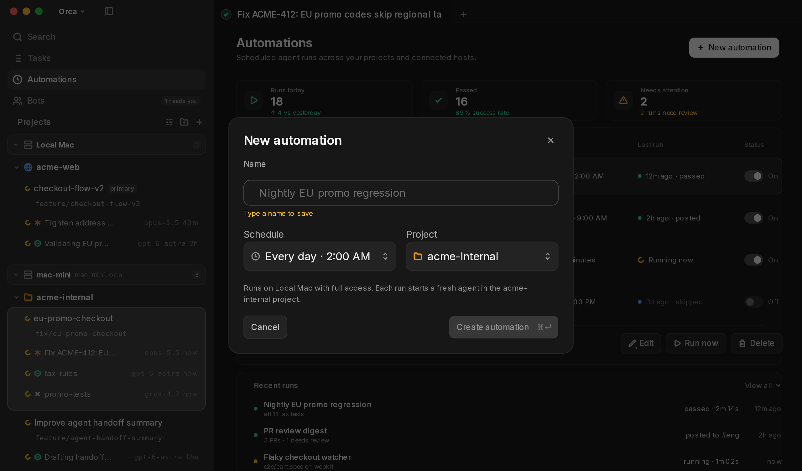

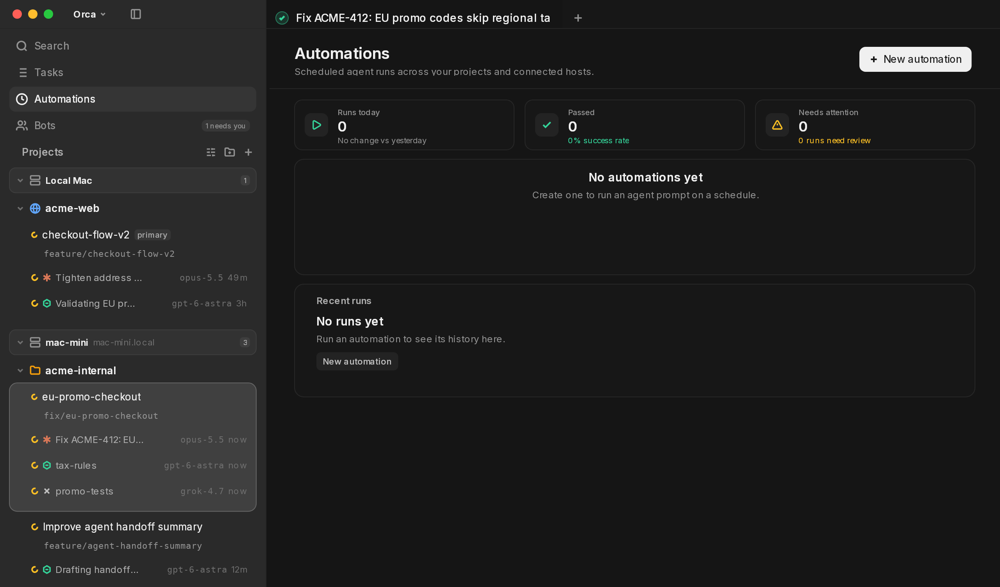

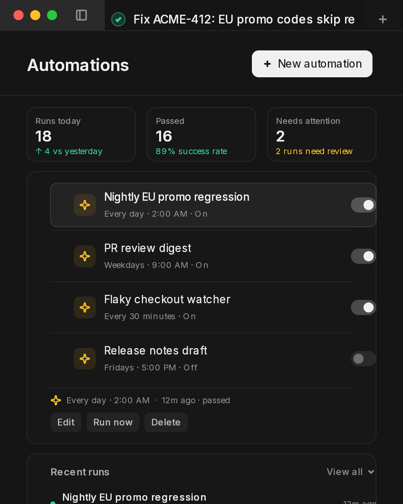

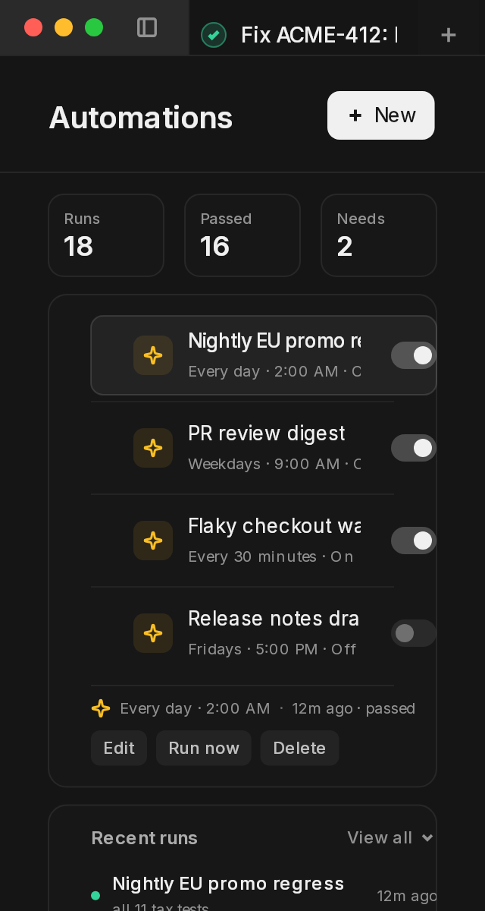

### Diff — review with line notes

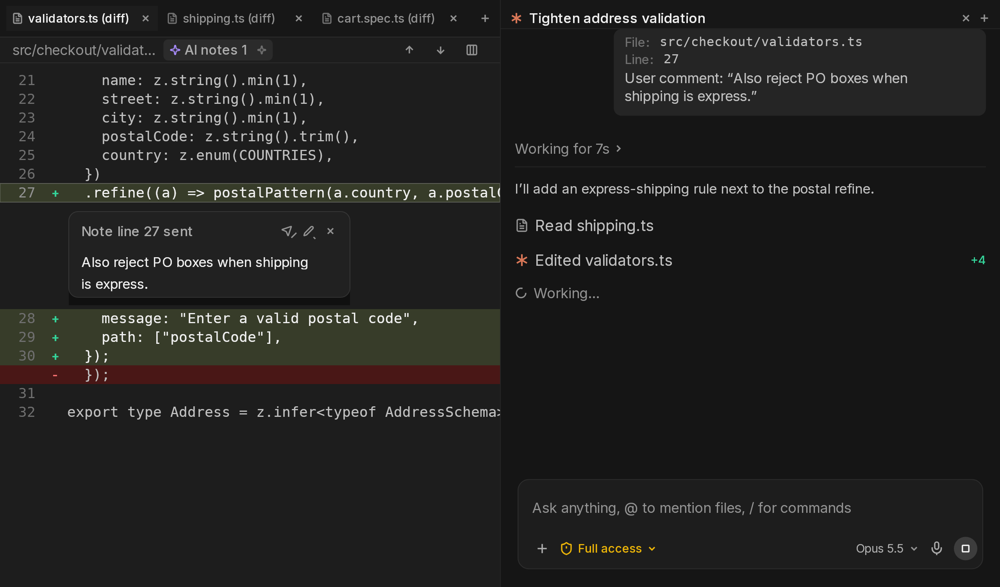

A 50/50 split: the diff pane has three switchable file tabs (`validators.ts`,
`shipping.ts`, `cart.spec.ts`); each tab closes with its X (the last open tab stays).
The screen is scoped to a worktree: **Show diff** on a worktree row opens that
worktree's title, agent, four-file review and transcript, resets the tab mask,
selection, note thread, draft and verdict when the worktree changes, and keeps the
current review when the same worktree is reopened. The seeded checkout review keeps
the reference's three open files plus a closed `handoff.md`; the completed
`checks-detail-link` review instead opens `checks.ts`, `checks.test.ts` and `ci.yml`,
shows verdicts and reads `Stopped`/`Worked for 7s`.
A tab-strip `+` opens a compact Files picker that lists every file with Showing / Open /
Closed status, switches to an existing tab, or restores a closed `handoff.md` tab; the
picker is clamped inside the diff pane and closes on a scrim click or `Escape`.
Once a tab would shrink below 120 px, the strip stops squeezing labels into unreadable
stubs: it shows the active tab at full width plus a live `N files` picker that still
switches between every open file and restores closed ones. The phone-width context card
uses the file's basename so `validators.ts` is never chopped in the middle of its name.
The active file shows a truncated path + note-count toolbar, +/− line rows set in mono 18
with 24 px line boxes and a
360px note card that opens inline under the selected line (the stacked narrow layout widens
it to the pane width, and later rows are pushed down); the chat
pane mirrors the note as a user comment and shows the agent’s working/tool rows. Switching
files closes the prior note thread and clears its draft so notes stay scoped to one file;
clicking the active tab keeps the current line. Selecting
a line attaches composer notes to that line, and once the run stops the context card’s
Approve / Request changes buttons set the verdict banner. The note card’s send icon resends
the note to the worker, the pencil loads it back into the composer for an in-place edit, and
the x deletes the note for that line. The toolbar’s split/focus icon collapses the chat pane
so the diff spans the full window; tapping it again (or pressing `Escape`) restores the
50/50 split. The code area scrolls when the rows plus the open note card exceed the pane.
At the reference's 480 px pane the toolbar keeps a 180 px path column (18 px text clipped
with an ellipsis), places the violet AI-notes pill at x≈211 with its trailing sparkle, and
right-aligns the arrow/focus controls at the reference's 25 px inset; narrower panes fall
back to a 20 px inset and tighter control spacing so nothing collides.
The chat pane’s header `x` performs the same collapse and its `+` opens Create worktree;
both show a hover state.
Shift+↑/↓ extends the selection into a line range; the note card then reads
`Note lines 24–28` and the note is stored against that whole range.
The diff composer mirrors the Projects composer: its Full-access chip cycles
Full access / Ask before edits / Read only and its model chip cycles Opus 5.5 /
GPT-6 Astra / Grok 4, and it sits on the same `#1d1d1d` card as the chat composer.
The card keeps the reference's 436 px width (22 px gutters) and dark 30 px send button,
with 15 px footer labels and an 18 px / 28 px placeholder that wraps to a second line at
960 widths. On phone widths the placeholder shortens to `Ask anything…` so it stays
inside the 56 px field instead of wrapping to a third line. Chat copy is 17.5/30 and
note bodies are 17.5/28, so both panes share the reference's reading scale.
Below 720 px the 50/50 split becomes an even vertical stack: at 480×600 each pane gets
299.5 px, the diff keeps about eight 24 px code rows and the agent chat transcript grows
to ~125 px above its 138 px composer, enough for the File / Line / User comment card.
Both toolbars and the composer stay at full window width.

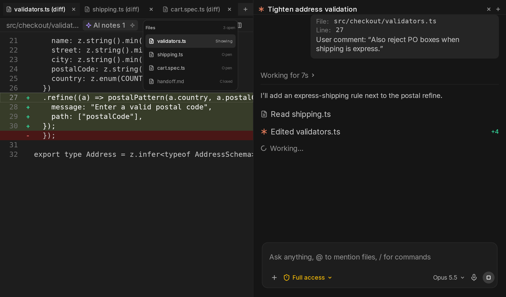

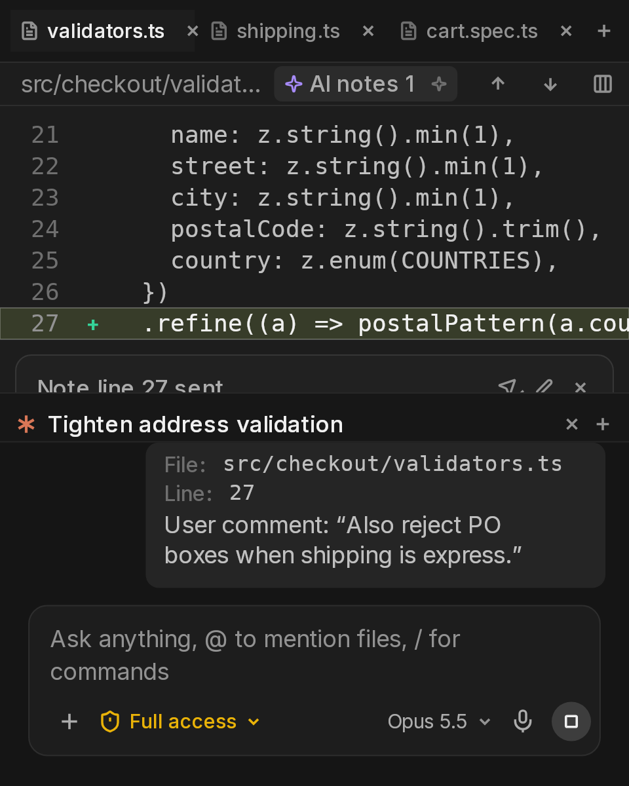

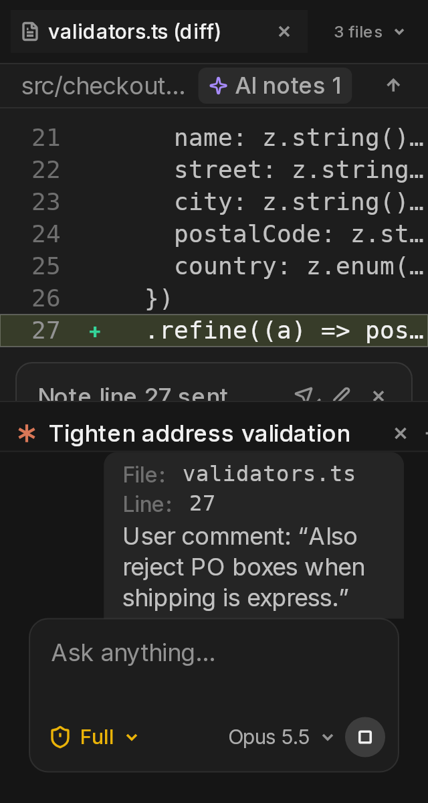

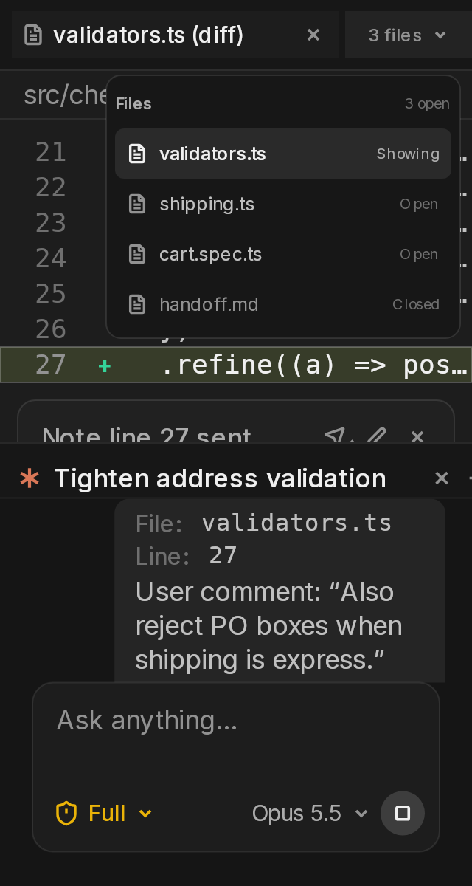

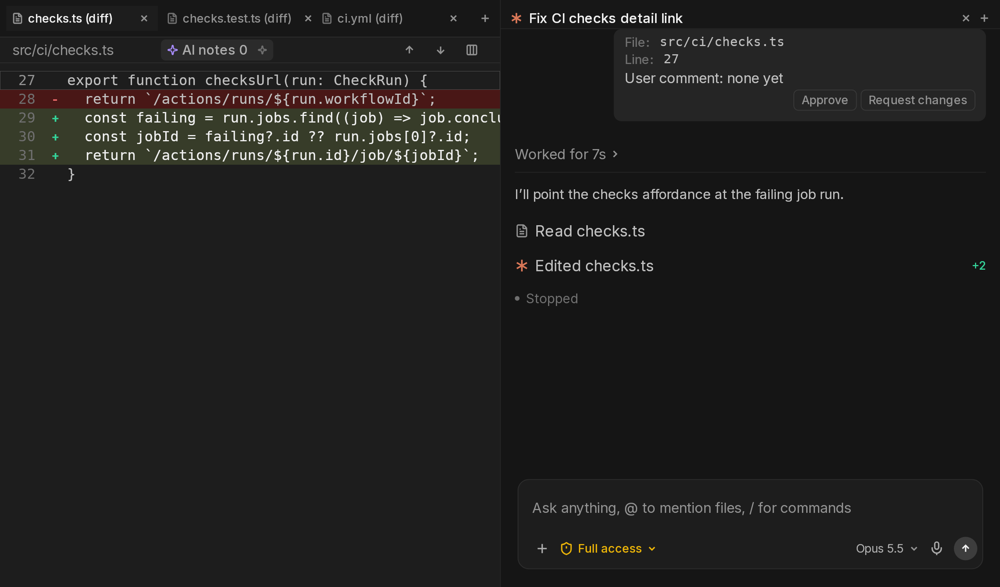

## Feature mapping to Orca

| Orca element | Implementation |
| --- | --- |
| Window chrome | `title_bar` / `bots_title_bar`: 12 px traffic lights, Orca wordmark, panel toggle, 36 px `#171717` bar |
| Sidebar nav | Search / Tasks / Automations / Bots rows on those pages; Bots carries a live needs-you badge that counts Waiting on you items and hides at zero; Projects hides the rail behind the Orca wordmark page switcher |
| Machine + project cards | `machine_card`, `project_block`, `worktree_row`, `agent_row` with status dots, brand glyphs and mono branch text |
| Worktree tabs | Tabs share the 36 px title row (right of the sidebar's 1 px vrule), active tab fills `#151515`; a lone tab caps at 375 px and multi-tab strips at 300 px; completed worktrees show a 16 px badge, close X appears on hover, and titles truncate at 48 characters |
| Transcript | Right-aligned user bubbles, assistant paragraphs (17.5/30), collapsible “Worked for …” rows, worker cards with focused white ring, live rows |
| Composer | Rounded `#171717` card, transparent field, Full-access chip, Opus selector, local-dictation mic and circular send button |
| Create worktree dialog | Scrim + 550 px card with selects, chips, unlabeled 52-high name field, agent select, Advanced row with a base-branch selector, toggle and 188 px primary action; blank Name source dims Create with a hint |
| Rename / delete dialogs | 440 px scrim cards: focused name field with a dimmed blank-name Rename action and hint, and a named destructive confirmation with Cancel/Delete |
| Bots sidebar | Section header, bordered selected bot card with nested sessions, other bot rows, Projects disclosure, account footer; a 1 px divider with a 9 px drag hit area resizes 220–380 px |
| Bots center | 383 px strip with a 143 px bot Home tab, 196 px `#eng` tab and plus; tool rows with inline chips, code spans, worked row, rich user bubble, closing follow-up |
| Bots right panel | Back-to-Home row, item title, tappable status menu (In progress / Waiting on you / Done), meta/chips, Chat and Done-means sections, activity rows, Scout question card with reply chip, comment composer; defaults to 400 px and sits flush to the window's right edge with no dark gutter, drags 320–480 px via a 1 px rule + 9 px hit area, tabs go icon-only under 360 px, and it collapses to a 48 px tab-icon rail; Scout card copy aligns under the avatar name, matching the reference |
| Status bar | Amber spark + 38% meter, Codex glyph + 12% meter, host label and host count |
| Avatars | Six deterministic vector mascots drawn from rounded containers (`Mascot` enum); the selected bot adds a 7 px amber status dot with a dark ring |
| Account avatar | 28 px neutral circle with an `M` initial and a small plus badge in the Bots footer |
| Search page | Page header, search field with clear hint, category pills, grouped hits, suggestions and empty state |
| Tasks page | Grouped list with dynamic counts, search, status/source filters, title-guarded task composer, detail pane with editable description, live worktree relink/unlink/create picker and persisted task activity timeline, Mark done / Reopen |
| Automations page | Metric cards, enable toggles, selected-row Edit/Run/Delete bar, New automation dialog with a dimmed blank-name action and expandable recent runs |
| Diff page | File tabs and `+` Files picker (switch open / restore closed), path/AI-notes toolbar, mono 18/24 annotated +/− rows, per-line or ranged notes (17.5/28) with send/edit/delete and approve/request-changes verdict |

## Interactions

- Selecting a worktree (sidebar row or agent row) opens/activates its tab; closing a tab
  falls back to the previous tab, then the empty state.
- Sending a message appends the user block and an assistant acknowledgement; the composer
  clears. Typing in the modal and submitting creates a slugged worktree.
- Clicking the modal's Agent row cycles Claude Code → Codex → Grok; the created worktree
  records that agent kind/model and its setup worker names it.
- Opening Advanced and clicking the base-branch row cycles main → develop → release/next;
  the created worktree's setup worker records the selected base.
- Clicking Project/Run on cycles acme-internal on mac-mini ↔ acme-web on Local Mac, and
  Create worktree lands in the chosen project. The composer access chip cycles Full access →
  Ask before edits → Read only; both model chips cycle Opus 5.5 → GPT-6 Astra → Grok 4.
- Clicking a composer mic appends its sample phrase to that surface's draft (Projects/Bots
  main, Bots comment or Diff), tints the mic amber and shows `Dictated locally` under the
  Bots composer; editing, picking a completion or sending clears the hint. No audio is
  recorded.
- The “Worked for …” rows expand/collapse.
- Clicking a worker card moves the focused white ring to it; clicking the focused card
  again clears the ring. The transcript only sends when a tab is open — an empty
  Projects pane keeps the draft instead of discarding it.
- On Bots: the Search / Tasks / Automations nav rows switch screens and the Projects
  disclosure returns to Projects; selecting a bot or nested session updates the
  center transcript and right item; center tabs Scout/#eng and panel tabs
  Home/Connectors/Chats/Files are selectable; **Behind a flag** toggles its selected
  state for that bot; comments submitted in the right panel append to the active bot's
  Activity list; sending from the center composer appends the message to that chat
  (scoped per bot/session). The
  Home panel's **Home Chat** row opens that bot's home session in the center pane; the
  **Chats** panel tab lists the active bot’s sessions and opens the clicked chat; the
  **Files** panel tab lists the indexed source files, and each row opens the worktree
  that owns it. The selected bot’s `more` icon opens the same fleet options panel as the
  header sliders button.
- Sending a new bot's first message creates a numbered Home item, updates the bot to
  `1 working`, and persists the item (title, status, chips, Done means, activity and any
  optional reply card) together with the next item number; seed bots keep their own
  sessions and items.
- The right panel's panel button collapses it to a 48 px rail with Home / Connectors /
  Chats / Files icons; an icon reopens the panel on that tab.
- The Files tab has a live path/project/summary/content filter, a matching count and an
  empty state; rows keep the same 8 px inner gutter and chevron placement as Chats,
  and a filtered row still opens the worktree that owns the file. Deleting a worktree
  retires its indexed files from the list and count, so no visible file row is a dead end.
- Bots center tabs close with their X: closing Scout falls back to `#eng`, closing both
  shows the “No chat open” state, and selecting a bot/session from the sidebar reopens it.
- Search: typing filters every worktree, bot and session; the category pills and
  suggestion chips update the query/count; `esc` (or clear) resets the query; a result
  row opens the worktree or bot it points to. The Files pill returns matching source files
  whose path, summary or indexed code keywords match the query. A leading `@` scopes the
  search to files and selects the Files pill; removing it restores the previous category.
  Tapping another category while scoped leaves the `@` scope and applies that category to
  the remaining text, while the Files pill keeps the scope. Pill counts preview what a tap
  will show, so under `@` the non-Files counts use the text after `@`.
  Deleting a worktree also removes its files from file search and from `@` completion.
  The first result is selected by default; ↑/↓ move the selection and `↵` opens it,
  even when the search field is not focused.
- Tasks: status and source pills filter the list and recompute group counts; the search
  box narrows by text, **Assigned to me** matches the seeded `you` assignees, and the detail
  Activity list names the assignee; the detail pane + highlighted row fall back to the first match;
  changing a filter or query re-settles the selection and discards an inline detail draft for a
  row that is no longer visible; selecting a row updates the detail pane; ↑/↓ walk the filtered rows and `↵` opens the
  selected task detail; while the new-task field is open, Enter submits that task instead;
  **New task** opens the inline composer from the list and `Escape` dismisses it; **Add**
  stays dimmed until a non-blank title is typed, then creates an initially unlinked task
  with the chosen source/agent; **Mark done** moves
  it to the Done group and **Reopen** moves it back. Both actions append a `now` row to the
  persisted Activity timeline, as do relink/unlink, description saves and new tasks.
- Tasks' linked-worktree control is a real relink/unlink flow: **Link** on an empty card,
  **Change** on a linked one, and **Close** while the inline picker is open. The picker lists
  only live worktrees with their branches, marks the current link, writes the chosen
  `worktree_id` and closes; **Unlink from this task** clears it. **Create worktree** opens
  the create dialog and links the newly created worktree on submit; cancelling clears the
  pending link. `Escape`, task/filter changes, **New task**, context menus, page changes and
  history navigation close the picker, and page Enter / Tasks ↑/↓ stay inert while it is open.
- Automations: each row’s toggle flips its enabled state; the selected row exposes
  **Edit** (prefilled dialog), **Run now** (fresh last run) and **Delete**; **New
  automation** opens the editor and ⌘↵ saves it once the name is non-blank; **View all**
  expands Recent runs, and clicking a run selects its automation; ↑/↓ move through the table
  and `↵` opens the
  selected automation editor. The metric cards
  read the persisted run/pass/attention counters, so Run now updates them immediately;
  the yesterday delta is derived from the persisted today/yesterday counters. Cancelling or
  saving the editor clears the name, schedule and project draft, so the next **New
  automation** starts blank instead of inheriting the edited automation. A blank or
  whitespace-only name keeps the editor open with an amber hint instead of creating
  “Untitled automation”.
- Diff: file tabs switch the diff and toolbar path; selecting a line scopes the note card
  and comment thread; sending from the composer attaches the note to that line; the card’s
  send / pencil / x resend, edit-in-place and delete the note; Approve / Request changes
  set the verdict banner; the tab-strip `+` opens an extra `handoff.md` diff tab.
  **Show diff** loads the review for the right-clicked worktree (checkout, EU promo,
  handoff or CI checks), with its own title, agent, file set and stopped/running state;
  switching worktrees clears the previous tabs, line range, note draft, notes and verdict.
  Each file tab’s X closes it, falling back to the next open file when it was active.
  Switching the active file closes an open note thread and clears its draft, so a note
  cannot be posted to a different file; re-clicking the active tab keeps the selection.
  The chat header’s `x` collapses the split and its `+` opens Create worktree.
  ↑/↓ move the selected line (clamped to the active file) and `Escape` closes an open note.
- `⌘K` / `Ctrl+K` opens Search from any screen; `⌘↵` / `Ctrl+Enter` submits the Create
  worktree dialog; `⌘W` / `Ctrl+W` closes the active Projects tab; `⌘P` / `Ctrl+P` returns
  to Projects; `Escape` dismisses the wordmark page menu, closes the modal, clears the
  search query, closes a diff note, dismisses the new-task composer, or cancels task
  description editing.
- On Search, Tasks and Automations, `↵` opens the selected result or row; overlays,
  open editors and compact sidebar/item-panel drawers keep page-level Enter inert so
  their own submit path still runs. The same overlays, the Bots status menu and those
  drawers also keep ↑/↓ inert, so arrow navigation never walks rows hidden behind an
  open menu, dialog or drawer.
- On Search, `Escape` also clears an active category filter; at compact widths `Escape`
  dismisses the Projects/Bots sidebar drawer and the Bots item-panel drawer.
- `⌘1`–`⌘9` switch to the first nine open worktree tabs and `⌘B` shows or hides the
  sidebar.
- The `←` / `→` buttons at the left of the Projects and Bots tab strips walk through
  screen, worktree and bot navigation history; `⌘[` / `⌘]` do the same from the keyboard.
- On Tasks, `⌘↵` saves the open description editor and `Escape` cancels it; on Diff,
  Shift+↑/↓ extends the selected line into a note range.
- The Bots sidebar help icon (`?`) opens a centered keyboard-shortcuts card listing the
  global keys; `Escape` or a click outside the card closes it. Below 330 px of card
  content the labels switch to short actions (`Create or save`, `Switch worktree tab`)
  so no row runs past the card's right edge.
- On Bots, ↑/↓ move through the filtered fleet (expanded, no filter field open) and open
  the newly selected bot’s Home panel.
- When the Bots fleet filter has no matches, the sidebar renders **Clear search**; it clears
  the query without closing the open filter field.
- Clicking the Bots Home status chip opens a three-state menu; choosing a row updates only
  the active bot, checks the selected state, closes the menu, and survives a restart.
  `Escape`, another bot, a panel tab or a page switch closes it without changing state.
- The Bots nav badge derives from those states: **1 needs you**, **2 need you**, and no
  badge at zero; the Bots standby copy uses the same live count.
- Clicking the title-bar **Orca** wordmark opens the Projects / Search / Tasks /
  Automations / Bots page switcher; its current row is filled, rows highlight on hover,
  and an outside click or `Escape` dismisses it. The panel button collapses/restores the
  sidebar. Nav rows, tabs, project headers, worktree rows, search hits, task rows,
  automation rows, diff lines and Bots
  Files rows all show a hover state. Drag the divider beside the Projects or Bots sidebar to resize it
  (220–380 px); session labels ellipsize to the new width and the divider shows a
  column-resize cursor.
- Drag the divider left of the Bots item panel to resize it (320–480 px); below 360 px
  the four panel tabs show icons only so they never overflow. Both Bots dividers use the same
  resize cursor and hover feedback.
- Narrow windows re-clamp the layout without losing the dragged preference: the Bots fleet and
  item panel shrink proportionally so the center chat keeps at least 300 px, the chat column
  caps at 736 px, and Tasks/Automations page bodies scale their columns to the available width.
  The Create worktree / Automation dialogs and the shortcuts card also shrink to the viewport
  with a 16 px gutter instead of clipping at narrow widths; below a 320 px content column
  their footers stack, the modal name field shrinks, and the automation Schedule/Project
  selects become full-width rows.
- Right-clicking a worktree row opens a context menu with **Open worktree**, **Show diff**,
  **Rename worktree**, **Close tab** and a destructive **Delete worktree**; right-clicking
  a task row offers **Open task** plus **Mark done** or **Reopen task**. Rename updates
  the row and tab title, `↵`/`⌘↵` commits a non-blank name, `Escape` cancels; a blank name
  keeps the dialog open with an amber hint. Delete asks for confirmation first, then closes
  the tab and unlinks tasks. **Show diff** always follows the row it was
  opened on instead of reusing the checkout review.
- The Bots tab-strip `+` opens the Create worktree dialog, same as the Projects strip.
- Machine cards and project headers collapse/expand their worktree lists (chevron
  indicator); the Bots screen uses the same panel button to hide its bot fleet.
- The Projects header sliders toggles an inline Collapse all / Expand all panel; its
  rows highlight on hover and `Escape` closes it.
- The automation editor is a real overlay: `Escape` or a scrim click cancels it, `⌘↵`
  saves a non-blank draft, and editing an existing automation keeps its last run and
  enabled state while clearing its name disables both save paths.
- Empty states stay actionable: the no-tab Projects pane offers **New worktree** and
  **Search**, a fruitless Search offers **Clear search**, and Tasks offers
  **Clear filters** in both the list and detail panes.
- User-authored state is persisted as versioned JSON: tasks (status, detail, new tasks),
  automations (toggle/run/edit/delete), diff notes and verdicts, bot comments and chat
  messages, added bots, created/renamed/deleted worktrees and their transcripts,
  connector toggles,
  collapsed machine/project rows and sidebar widths survive a restart. The composer's
  access/model choices, the active bot session and center/panel tab, whether the bot chat
  and `#eng` tab were open, and the Show-sessions display preference also persist.
  Transient overlays, drafts and search/filter text are not saved.

## Project layout

```text
app/
  model.mbt        Core model, messages, pure update, seed workspace, tests helpers
  model_bots.mbt   Phase-2 bot/session/item data types and fleet seed
  theme.mbt        Pinned dark palette, fonts, borders
  brand.mbt        Brand glyphs and custom single-path SVG icons
  view.mbt         Window shell, sidebar, tab strip, chat routing, empty states
  view_chat.mbt    Transcript blocks, worked rows, worker cards, composer
  view_modal.mbt   Create-worktree dialog
  view_bots.mbt    Three-pane Bots screen, item panel, status bar, mascots
  view_pages.mbt   Search / Tasks / Automations pages, filters and page chrome
  view_diff.mbt    Diff review screen, file tabs, line notes, verdicts
  app.mbt          program() / program_with_model()
  persist.mbt      Versioned JSON save/load for durable model state
  app_test.mbt     Model/update tests
scenes/
  hero/            default screenshot scene (Projects)
  app_menu/        Projects with the Orca wordmark page menu open
  composer_commands/  Projects with the `/` command picker open
  composer_mentions/  Projects with the `@` file picker filtered by checkout
  modal/           modal screenshot scene
  bots/            Bots screenshot scene
  bots_files/      Bots Files tab filtered by indexed code content
  bots_status/     Bots Home status menu with Scout waiting on you
  bots_new/        Newly added bot with the empty Home Chat intro
  bots_new_chat/   Newly added bot after its first Home Chat message
  bots_dictation/  Bots composer after the local dictation demo runs
  bots_panel_narrow/  narrow Bots item panel drawer
  help_narrow/     keyboard-shortcuts card at phone width
  search/          Search page screenshot scene
  tasks/           Tasks page screenshot scene
  tasks_link/      Tasks detail with the worktree link picker and create action
  tasks_link_phone/  phone-width Tasks detail with the worktree picker open
  tasks_composer/  Tasks composer with a blank title and disabled Add
  tasks_list_narrow/  narrow Tasks list with detail closed
  automations/     Automations page screenshot scene
  automation_editor/  Automations dialog screenshot scene
  automation_editor_blocked/  Automations dialog with a blank name and disabled save
  diff/            Diff review screenshot scene
  diff_files/      Diff review with the tab-strip Files picker open
  diff_phone_menu/  phone-width Diff review with the file picker open
  rename_worktree/   rename dialog screenshot scene
  rename_worktree_blocked/  rename dialog with a blank name and disabled Rename
  delete_worktree/   delete confirmation screenshot scene
  worktree_menu/     worktree context-menu screenshot scene
linux_skia/        thin native entrypoint (1280×800 window, titled “Orca”)
web_wasm/          thin wasm-gc entrypoint
design/            owner-supplied references and spec
docs/screenshots/  rendered acceptance screenshots
```

All app logic lives under `app/`; `linux_skia/` and `web_wasm/` only start the runtime,
and each scene exposes `pub fn program()` importing just `local/orca_moui/app` and
`wzzc-dev/moui`.

## Run

The project targets the published `wzzc-dev/moui@0.9.1` package; it is not a member of the
MoUI monorepo workspace.

```sh
export PATH="/home/chuang/bin:$HOME/.moon/bin:$PATH"
# The host has no libvulkan, so use the raster backend.
export MOUI_SKIA_ENABLE_GPU_VULKAN=0

moon check --target native
moon test app --target native
moon build linux_skia --target native
moon run linux_skia --target native      # native window, 1280×800, titled “Orca”
moon build web_wasm --target wasm-gc     # web build in _build/wasm-gc/.../web_wasm.wasm
```

The theme is pinned to dark inside the app, so `--scheme` never changes the look.

## Screenshots

The 50 acceptance screenshots are rendered by the MoUI CLI at logical 1280×752 with
scale 2 (2560×1504 output); the narrow Projects, Search, Tasks, Automations, Bots and Diff
shots use 480×600, while the phone-breakpoint Create worktree, Bots panel, Bots chat,
shortcuts card, Search, Tasks list, Tasks composer, Tasks link, Automations and Diff
shots use 320×600:

```sh
moui screenshot --app scenes/hero  --out docs/screenshots/orca.png \
  --width 1280 --height 752 --scheme dark
moui screenshot --app scenes/app_menu --out docs/screenshots/app-menu.png \
  --width 1280 --height 752 --scheme dark
moui screenshot --app scenes/hero_narrow --out docs/screenshots/orca-narrow.png \
  --width 480 --height 600 --scheme dark
moui screenshot --app scenes/composer_commands --out docs/screenshots/composer-commands.png \
  --width 1280 --height 752 --scheme dark
moui screenshot --app scenes/composer_mentions --out docs/screenshots/composer-mentions.png \
  --width 1280 --height 752 --scheme dark
moui screenshot --app scenes/modal --out docs/screenshots/orca-create-worktree.png \
  --width 1280 --height 752 --scheme dark
moui screenshot --app scenes/modal_advanced --out docs/screenshots/orca-create-worktree-advanced.png \
  --width 1280 --height 752 --scheme dark
moui screenshot --app scenes/modal --out docs/screenshots/orca-create-worktree-narrow.png \
  --width 320 --height 600 --scheme dark
moui screenshot --app scenes/help_narrow --out docs/screenshots/help-narrow.png \
  --width 320 --height 600 --scheme dark
moui screenshot --app scenes/rename_worktree --out docs/screenshots/worktree-rename.png \
  --width 1280 --height 752 --scheme dark
moui screenshot --app scenes/rename_worktree_blocked \
  --out docs/screenshots/worktree-rename-blocked.png \
  --width 1280 --height 752 --scheme dark
moui screenshot --app scenes/rename_worktree_blocked \
  --out docs/screenshots/worktree-rename-blocked-narrow.png \
  --width 480 --height 600 --scheme dark
moui screenshot --app scenes/delete_worktree --out docs/screenshots/worktree-delete.png \
  --width 1280 --height 752 --scheme dark
moui screenshot --app scenes/worktree_menu --out docs/screenshots/worktree-menu.png \
  --width 1280 --height 752 --scheme dark
moui screenshot --app scenes/bots  --out docs/screenshots/orca-bots.png \
  --width 1280 --height 752 --scheme dark
moui screenshot --app scenes/bots_narrow --out docs/screenshots/bots-narrow.png \
  --width 480 --height 600 --scheme dark
moui screenshot --app scenes/bots_panel_narrow --out docs/screenshots/bots-panel-narrow.png \
  --width 480 --height 600 --scheme dark
moui screenshot --app scenes/bots_panel_narrow --out docs/screenshots/bots-panel-phone.png \
  --width 320 --height 600 --scheme dark
moui screenshot --app scenes/bots_narrow --out docs/screenshots/bots-phone.png \
  --width 320 --height 600 --scheme dark
moui screenshot --app scenes/bots_files --out docs/screenshots/bots-files.png \
  --width 1280 --height 752 --scheme dark
moui screenshot --app scenes/bots_status --out docs/screenshots/bots-status.png \
  --width 1280 --height 752 --scheme dark
moui screenshot --app scenes/bots_new --out docs/screenshots/bots-new.png \
  --width 1280 --height 752 --scheme dark
moui screenshot --app scenes/bots_new_chat --out docs/screenshots/bots-new-chat.png \
  --width 1280 --height 752 --scheme dark
moui screenshot --app scenes/bots_dictation --out docs/screenshots/bots-dictation.png \
  --width 1280 --height 752 --scheme dark
moui screenshot --app scenes/search --out docs/screenshots/search.png \
  --width 1280 --height 752 --scheme dark
moui screenshot --app scenes/search_files --out docs/screenshots/search-files.png \
  --width 1280 --height 752 --scheme dark
moui screenshot --app scenes/search_narrow --out docs/screenshots/search-narrow.png \
  --width 480 --height 600 --scheme dark
moui screenshot --app scenes/search_narrow --out docs/screenshots/search-phone.png \
  --width 320 --height 600 --scheme dark
moui screenshot --app scenes/tasks --out docs/screenshots/tasks.png \
  --width 1280 --height 752 --scheme dark
moui screenshot --app scenes/tasks_link --out docs/screenshots/tasks-link.png \
  --width 1280 --height 752 --scheme dark
moui screenshot --app scenes/tasks_link_phone \
  --out docs/screenshots/tasks-link-phone.png \
  --width 320 --height 600 --scheme dark
moui screenshot --app scenes/tasks_composer --out docs/screenshots/tasks-composer.png \
  --width 1280 --height 752 --scheme dark
moui screenshot --app scenes/tasks_composer \
  --out docs/screenshots/tasks-composer-narrow.png \
  --width 480 --height 600 --scheme dark
moui screenshot --app scenes/tasks_composer \
  --out docs/screenshots/tasks-composer-phone.png \
  --width 320 --height 600 --scheme dark
moui screenshot --app scenes/tasks_narrow --out docs/screenshots/tasks-narrow.png \
  --width 480 --height 600 --scheme dark
moui screenshot --app scenes/tasks_list_narrow --out docs/screenshots/tasks-list-narrow.png \
  --width 480 --height 600 --scheme dark
moui screenshot --app scenes/tasks_list_narrow \
  --out docs/screenshots/tasks-list-phone.png \
  --width 320 --height 600 --scheme dark
moui screenshot --app scenes/automations --out docs/screenshots/automations.png \
  --width 1280 --height 752 --scheme dark
moui screenshot --app scenes/automations_scheduled \
  --out docs/screenshots/automations-scheduled.png \
  --width 1280 --height 752 --scheme dark
moui screenshot --app scenes/automations_empty --out docs/screenshots/automations-empty.png \
  --width 1280 --height 752 --scheme dark
moui screenshot --app scenes/automations_narrow --out docs/screenshots/automations-narrow.png \
  --width 480 --height 600 --scheme dark
moui screenshot --app scenes/automations_narrow --out docs/screenshots/automations-phone.png \
  --width 320 --height 600 --scheme dark
moui screenshot --app scenes/automation_editor --out docs/screenshots/automations-editor.png \
  --width 1280 --height 752 --scheme dark
moui screenshot --app scenes/automation_editor_blocked \
  --out docs/screenshots/automations-editor-blocked.png \
  --width 1280 --height 752 --scheme dark
moui screenshot --app scenes/diff --out docs/screenshots/diff.png \
  --width 1280 --height 752 --scheme dark
moui screenshot --app scenes/diff_files --out docs/screenshots/diff-files.png \
  --width 1280 --height 752 --scheme dark
moui screenshot --app scenes/diff_narrow --out docs/screenshots/diff-narrow.png \
  --width 480 --height 600 --scheme dark
moui screenshot --app scenes/diff_narrow --out docs/screenshots/diff-phone.png \
  --width 320 --height 600 --scheme dark
moui screenshot --app scenes/diff_phone_menu \
  --out docs/screenshots/diff-phone-files.png \
  --width 320 --height 600 --scheme dark
moui screenshot --app scenes/diff_checks --out docs/screenshots/diff-checks.png \
  --width 1280 --height 752 --scheme dark
```

## Notes

- Typography uses the host's Inter family with DejaVu Sans Mono for branch/code text; the
  layout is tuned to the reference's proportions rather than shipping font files.
- Bot mascots are drawn as colored rounded squares with simple faces (the reference webp
  assets are not loaded); each of the six bots has its own palette.
- The app is a local UI replica: transcripts, fleet and other demo data are seeded in
  `Model::new()` and driven locally by pure `update` messages. There is no network or agent
  backend. Durable user state is written to `~/.orca-moui-state.json` (or the path in
  `MOUI_DEV_STATE_FILE`) after each update and restored on launch on native; web builds use
  browser localStorage through the settings key `orca-moui.state`. Delete the state file or
  clear site data to reset the demo.
- Known deliberate deviations are the mascot illustration style. The Bots sidebar defaults
  to 272 px and the item panel to 400 px, but both drag wider or narrower. The chat column
  follows Orca’s default
  46rem (736 px) max width so the transcript and composer share one measure.
- The footer account avatar is an initial mark rather than a photo, since the replica has
  no account backend or image picker.
