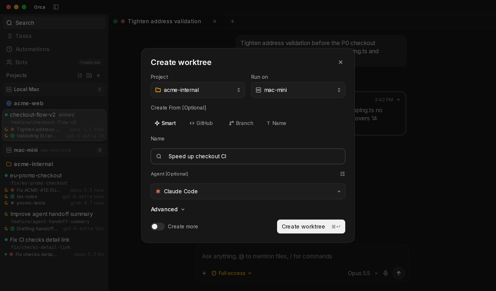

# Orca — a MoUI replica

A native, fully client-side replica of the **Orca agent IDE** desktop app, built with
[MoUI](https://github.com/wzzc-dev/moui) 0.9.1 in MoonBit. The app reproduces the
owner-supplied Orca reference screens in a pinned dark theme and runs as a native
Linux/Skia desktop window or as a WebAssembly web build.

The UI is state-driven with MoUI's TEA-style `Program[Model, Msg]`: a single `Model`
holds the workspace, bot fleet and panel state, `update` is a pure `(Model, Msg) -> Model`
function, and `view` renders `View[Msg]` trees. Every pixel of chrome — traffic lights,
tabs, tool rows, chips, mascots, meters — is composed from MoUI primitives; no bitmap
assets are loaded.

## Screens

### Projects — worktree chat


The default workspace. A 280 px sidebar lists machines and projects, worktree rows with
branch and agent metadata, and a four-item nav rail. The main pane has a worktree tab
strip, a scrollable transcript (user bubbles, assistant copy, collapsible worked rows,
focused worker cards, live status), and the Orca composer with a Full-access chip, model
selector, mic and send button.

### Create worktree modal



Opened from the sidebar's plus / folder-plus buttons, the tab strip plus, or `⌘K`-style
flow. Project and Run-on selects, Create From chips (Smart / GitHub / Branch / Name), a
name field, an agent select, an Advanced disclosure, a Create-more toggle, and the
Create worktree action with a `⌘↵` hint. Submitting creates a slugged worktree, adds it
to `acme-internal`, opens its tab and seeds the new transcript.

### Bots — three-pane agent fleet


A 272 px sidebar with the bot fleet (selected Scout card with nested Home Chat, Claude,
Codex and Slack sessions), a 380 px right item panel (Home / Connectors / Chats / Files),
and the center Scout chat transcript and composer. A 24 px status bar spans the bottom
with deterministic capacity meters. The screen is reachable from the **Bots** nav item;
Projects/Search nav returns to the phase-1 workspace.

## Feature mapping to Orca

| Orca element | Implementation |
| --- | --- |
| Window chrome | `title_bar` / `bots_title_bar`: 12 px traffic lights, Orca wordmark, panel toggle, 36 px `#171717` bar |
| Sidebar nav | Search / Tasks / Automations / Bots rows; Bots carries the “1 needs you” badge |
| Machine + project cards | `machine_card`, `project_block`, `worktree_row`, `agent_row` with status dots, brand glyphs and mono branch text |
| Worktree tabs | Active tab fills `#151515`, flush with the transcript, close cross plus new-tab button |
| Transcript | Right-aligned user bubbles, assistant paragraphs (15/21), collapsible “Worked for …” rows, worker cards with focused white ring, live rows |
| Composer | Rounded `#171717` card, transparent field, Full-access chip, Opus selector, mic and circular send button |
| Create worktree dialog | Scrim + 550 px card with selects, chips, name field, agent select, Advanced row, toggle and primary action |
| Bots sidebar | Section header, bordered selected bot card with nested sessions, other bot rows, Projects disclosure, account footer |
| Bots center | Scout / #eng tabs, tool rows with inline chips, code spans, worked row, rich user bubble, closing follow-up |
| Bots right panel | Back-to-Home row, item title/status/meta/chips, Chat and Done-means sections, activity rows, Scout question card with reply chip, comment composer |
| Status bar | Amber spark + 38% meter, Codex glyph + 12% meter, host label and host count |
| Avatars | Six deterministic vector mascots drawn from rounded containers (`Mascot` enum) |

## Interactions

- Selecting a worktree (sidebar row or agent row) opens/activates its tab; closing a tab
  falls back to the previous tab, then the empty state.
- Sending a message appends the user block and an assistant acknowledgement; the composer
  clears. Typing in the modal and submitting creates a slugged worktree.
- The “Worked for …” rows expand/collapse.
- On Bots: **Bots** nav switches screens; selecting a bot or nested session updates the
  center transcript and right item; center tabs Scout/#eng and panel tabs
  Home/Connectors/Chats/Files are selectable; **Behind a flag** toggles its selected
  state; comments submitted in the right panel append to the Activity list.
- `Escape` closes the modal.

## Project layout

```text
app/
  model.mbt        Core model, messages, pure update, seed workspace, tests helpers
  model_bots.mbt   Phase-2 bot/session/item data types and fleet seed
  theme.mbt        Pinned dark palette, fonts, borders
  brand.mbt        Brand glyphs and custom single-path SVG icons
  view.mbt         Window shell, sidebar, tab strip, chat routing, empty states
  view_chat.mbt    Transcript blocks, worked rows, worker cards, composer
  view_modal.mbt   Create-worktree dialog
  view_bots.mbt    Three-pane Bots screen, item panel, status bar, mascots
  app.mbt          program() / program_with_model()
  app_test.mbt     Model/update tests
scenes/
  hero/            default screenshot scene (Projects)
  modal/           modal screenshot scene
  bots/            Bots screenshot scene
linux_skia/        thin native entrypoint (1280×800 window, titled “Orca”)
web_wasm/          thin wasm-gc entrypoint
design/            owner-supplied references and spec
docs/screenshots/  rendered acceptance screenshots
```

All app logic lives under `app/`; `linux_skia/` and `web_wasm/` only start the runtime,
and each scene exposes `pub fn program()` importing just `local/orca_moui/app` and
`wzzc-dev/moui`.

## Run

The project targets the published `wzzc-dev/moui@0.9.1` package; it is not a member of the
MoUI monorepo workspace.

```sh
export PATH="/home/chuang/bin:$HOME/.moon/bin:$PATH"
# The host has no libvulkan, so use the raster backend.
export MOUI_SKIA_ENABLE_GPU_VULKAN=0

moon check --target native
moon test app --target native
moon build linux_skia --target native
moon run linux_skia --target native      # native window, 1280×800, titled “Orca”
moon build web_wasm --target wasm-gc     # web build in _build/wasm-gc/.../web_wasm.wasm
```

The theme is pinned to dark inside the app, so `--scheme` never changes the look.

## Screenshots

The acceptance screenshots are rendered by the MoUI CLI at logical 1280×752 with scale 2
(2560×1504 output):

```sh
moui screenshot --app scenes/hero  --out docs/screenshots/orca.png \
  --width 1280 --height 752 --scheme dark
moui screenshot --app scenes/modal --out docs/screenshots/orca-create-worktree.png \
  --width 1280 --height 752 --scheme dark
moui screenshot --app scenes/bots  --out docs/screenshots/orca-bots.png \
  --width 1280 --height 752 --scheme dark
```

## Notes

- Typography uses the host's Inter family with DejaVu Sans Mono for branch/code text; the
  layout is tuned to the reference's proportions rather than shipping font files.
- Bot mascots are drawn as colored rounded squares with simple faces (the reference webp
  assets are not loaded); each of the six bots has its own palette.
- The app is a static UI replica: transcripts, fleet state and activity are seeded in
  `Model::new()` / `bots_seed()` and driven locally by messages. There is no network or
  agent backend.
- Known deliberate deviations are the phase-1 chat column cap (540 px), the phase-2 Bots
  sidebar (272 px) and right panel (380 px), and the mascot illustration style.
